<div align="center">

# TEDEX — Thermoelectric Data, Modeling & Plotting Harness

**Unified Python CLI, Physics Modeling Suite & AI Agent Plugin for Thermoelectric Research (`v1.5.0`)**

[**English**](README.md) | [**简体中文**](README_ZH.md) · [Showcase Gallery](showcase/README.md) · [Command Reference](docs/COMMANDS.md) · [SciPlot Guide](docs/SCIPLOT.md) · [Color Palettes](docs/COLOR_SETS.md)

</div>

---

**TEDEX** (`tedex` / `te_analysis`) is an end-to-end Python package, command-line toolkit, and modular **AI Agent Harness** for thermoelectric (TE) materials research. It unifies raw ZEM/LFA data processing, collision-free publication plotting (`plot-te`, `sciplot`, `plot-xrd`), XRD structural & variable-temperature analysis (`xrd-lattice`), and rigorous phonon/electronic transport modeling (`debye-calc`, `callaway`, `debye-einstein`, `spb`, `skb`, `two-band`) behind one deterministic CLI (`te` / `python main.py`).

## Highlights

- **Clean Software / Data Decoupling (Mode-B Ready)** — Install `tedex` and its 5 orthogonal AI skills once in the software layer; initialize any clean research folder via `te init` (`configs/workspace.json`) with zero `.py` or skill clutter inside user data directories.
- **Publication-Grade Typography & Collision-Free Inside Legends** — Consistent journal styling (`science` high-contrast categorical & monochromatic ramps, `soft-br` 2D maps, `#79ADD8`/`#264B73` experimental markers + `#E64B35` best-fit curves) with smart temperature tick snapping (`300, 400, 500, 600 K`) and an automatic `legend_layout` engine that keeps legends inside axes without overlapping curves or bars.
- **20+ Scientific Chart Types & JSON Recipes (`sciplot`)** — Render 1D curves, stacked/percent bars, waterfalls, broken axes, 2D contour/phase maps, heatmaps, ternary diagrams, ML parity plots, Arrhenius fits, and radar charts from CLI flags or reusable JSON recipes.
- **Full-Stack XRD Analysis (`plot-xrd` & `xrd-lattice`)** — Stacked/separate patterns, dual PDF stick cards, peak-shift zoom panels, in-situ variable-temperature (`vt-map` / `vt-stack`) phase maps, Rietveld refinement profiles, pseudo-Voigt peak deconvolution, Williamson–Hall size/strain plots, and Bragg unit-cell refinement.
- **Rigorous Transport Physics & Diagnostics** — Multi-mechanism Debye–Callaway $\kappa_{\mathrm{L}}(T)$ & spectral MFP, Debye $\Theta_{\mathrm{D}}$ / $v_{\mathrm{s}}$ calculator, cryogenic $C_p/T^3$ rattler boson-peak fitting, SPB, non-parabolic SKB, and Two-Band (`convergence`, `bipolar`, `semimetal`) models—complete with SVD Jacobian condition numbers, 95% CIs, parameter correlation warnings, and exit-code `2` missing-constant safeguards.

---

## Visual Gallery

> Click any vector thumbnail below to inspect full resolution, or explore all 8 reproducible end-to-end cases in [`showcase/`](showcase/README.md).

<p align="center">
  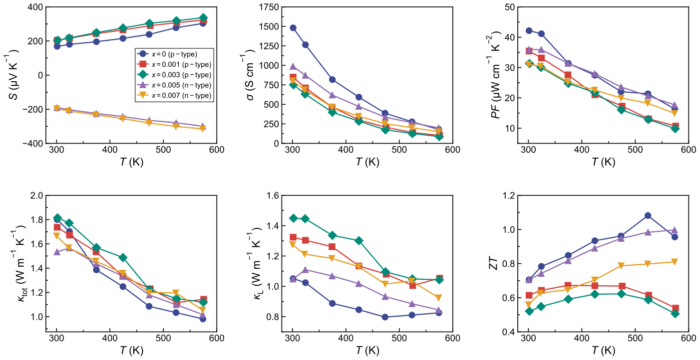<br />
  <sub><b>2×3 Classical TE Transport Summary</b> (<code>plot-te --plot-mode combined</code>: <i>S</i>, <i>σ</i>, <i>PF</i>, <i>κ</i><sub>tot</sub>, <i>κ</i><sub>L</sub>, <i>ZT</i> across p→n doping transition)</sub>
</p>

<table>
  <tr>
    <td align="center" width="50%">
      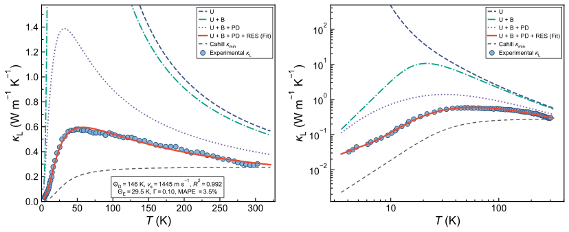<br />
      <sub><b>Debye–Callaway κ<sub>L</sub>(T) Cascade</b> (<code>callaway</code>: U + B + PD + RES)</sub>
    </td>
    <td align="center" width="50%">
      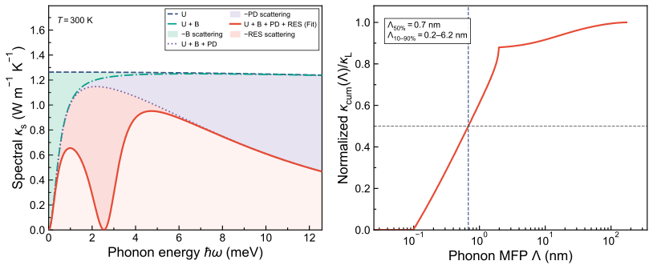<br />
      <sub><b>Spectral κ<sub>s</sub>(ℏω) &amp; Cumulative MFP Λ<sub>50%</sub></b> (<code>callaway</code>)</sub>
    </td>
  </tr>
  <tr>
    <td align="center" width="50%">
      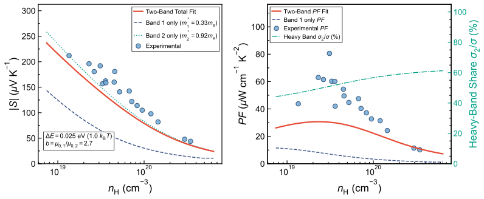<br />
      <sub><b>Two-Band Valence Convergence</b> (<code>two-band --mode convergence</code>)</sub>
    </td>
    <td align="center" width="50%">
      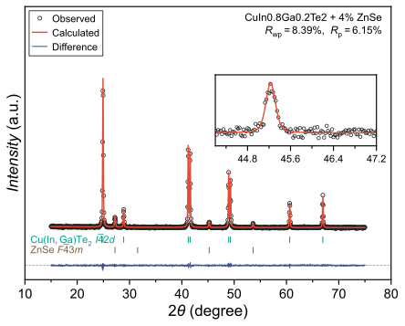<br />
      <sub><b>Rietveld Profile, Bragg Ticks &amp; Zoom Inset</b> (<code>plot-xrd --rietveld</code>)</sub>
    </td>
  </tr>
</table>

<table>
  <tr>
    <td align="center" width="33%">
      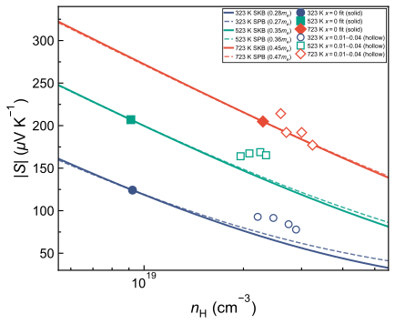<br />
      <sub><b>Multi-T SKB vs SPB Pisarenko</b> (<code>skb</code>)</sub>
    </td>
    <td align="center" width="33%">
      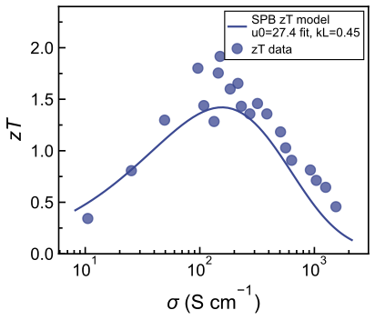<br />
      <sub><b>SPB zT vs Conductivity</b> (<code>spb conductivity</code>)</sub>
    </td>
    <td align="center" width="33%">
      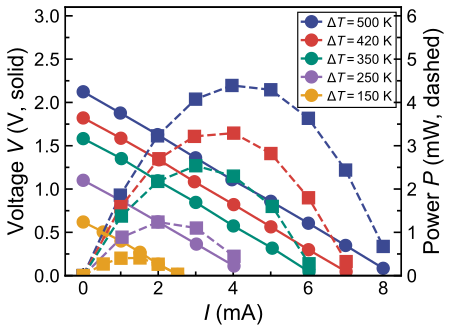<br />
      <sub><b>TEG Module I–V &amp; Output Power</b> (<code>sciplot</code>)</sub>
    </td>
  </tr>
  <tr>
    <td align="center" width="33%">
      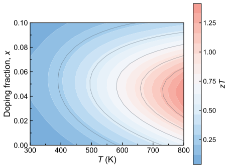<br />
      <sub><b>2D (T, x) zT Phase Contour</b> (<code>sciplot</code>)</sub>
    </td>
    <td align="center" width="33%">
      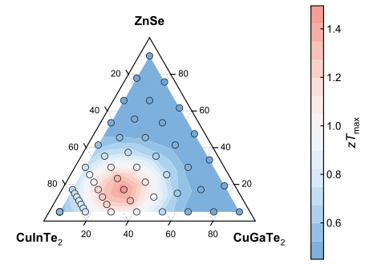<br />
      <sub><b>Ternary Composition Map</b> (<code>sciplot</code>)</sub>
    </td>
    <td align="center" width="33%">
      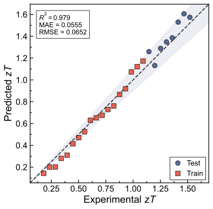<br />
      <sub><b>ML Parity &amp; ±10% Error Band</b> (<code>sciplot</code>)</sub>
    </td>
  </tr>
</table>

---

## Installation & Operating Modes

### 1. Install Python Dependencies & CLI

Requires **Python >= 3.10**. Installing in editable (or standard) mode registers global CLI entry points (`te`, `tedex`, `te-init`, `te-plot-te`, `te-plot-xrd`, `te-sciplot`, and `te-spb-*`):

```bash
git clone https://github.com/<your-username>/tedex.git
cd tedex
pip install -r requirements.txt
pip install -e .
```

Verify the installation:

```bash
te --help
# (or without editable install: python main.py --help)
```

### 2. Choose Your Workflow Mode

TEDEX supports two complementary setups for humans and AI coding agents (Antigravity, Claude Code / Cowork, Codex, Cursor):

1. **Mode B — Software-Layer Plugin + Clean User Data Folder *(Recommended)***:
   - Copy or symlink [`plugin/tedex`](plugin/tedex/README.md) into `~/.gemini/config/plugins/tedex` (or load it as an agent plugin).
   - Open **any empty research folder** (e.g. `D:/Research/CuInTe2_Project`). Your project directory contains **only** `configs/workspace.json`, `data/`, and `outputs/`—zero Python scripts or skill files.
   - Run `te init` (or ask the AI agent to initialize the folder) to confirm folder paths, subfolder grouping (`by_batch`, `by_system_batch`, or `by_project`), and instrument conventions once.
2. **Mode A — All-in-One Repository Harness**:
   - Open this repository root directly in your IDE or agent CLI. The agent automatically loads [AGENTS.md](AGENTS.md) / [CLAUDE.md](CLAUDE.md) and discovers the 5 skills under `.agents/skills/`.

<p align="center">
  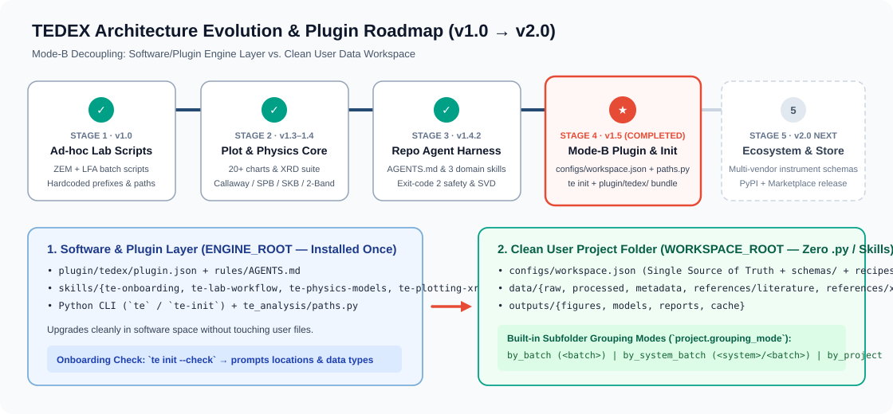
</p>

---

## Feature Guide & Complete CLI Reference

Every command below can be invoked either as **`te <command> ...`** (anywhere after `pip install -e .`) or as **`python main.py <command> ...`** (from the repository root). Pass `-w / --workspace <DIR>` before `<command>` to target another workspace directory explicitly.

### 1. Workspace Initialization & Configuration (`init`)

Scaffolds a clean user workspace, writes [`configs/workspace.json`](configs/workspace_template.json), creates starter metadata ledgers (`batches.json`, `samples.json`, `lab_metadata.md`), and configures subfolder naming rules via `te_analysis/paths.py`.

```bash
# Check whether the current folder is initialized (exits 0 if ready, 2 with onboarding checklist if not)
te init --check
te init --status --json

# Interactive wizard (press Enter to accept defaults)
te init

# Non-interactive setup with two-level <system>/<batch_id> grouping and custom XRD source
te init --yes \
  --name "CuInTe2 Doping Study" \
  --grouping by_system_batch \
  --batch-prefix "CIT" \
  --xrd-cards-dir "D:/SharedLab/XRD_PDF_Cards" \
  --xrd-radiation Cu-Ka \
  --formats svg png
```

| Key Option | Description |
| --- | --- |
| `--check` / `--status` / `--json` | Inspect resolved paths and conventions without modifying files (`--check` exits `2` if uninitialized). |
| `--grouping {by_batch,by_system_batch,by_project}` | Subfolder topology under `raw/`, `processed/`, and `figures/`. |
| `--batch-prefix <PREFIX>` | Optional ID prefix shorthand (e.g. `TE`, `SNSE`, or `""` for free naming). |
| `--raw-dir`, `--processed-dir`, `--metadata-dir`, `--xrd-cards-dir`, `--figures-dir`, `--models-dir`, `--reports-dir` | Map any logical directory to a custom relative or external absolute path. |
| `--xrd-radiation` / `--xrd-wavelength` | Set default XRD anode (`Cu-Ka` `1.5406 Å`, `Mo-Ka` `0.71073 Å`, `Co-Ka` `1.78897 Å`, or custom Å). |

---

### 2. Raw ZEM + LFA Pipeline, Metadata Sync & Bayesian Screening (`analyze`, `sync`, `assess`, `bayes`)

Processes raw electrical transport (`<sample_id>_ZEM.txt`) and thermal diffusivity (`<sample_id>_LFA.csv` or `.xlsx`) files paired with sample `density` and `cp_value` from `lab_metadata.md` / `samples.json` to compute $\sigma$, $S$, $PF$, $\kappa$, $zT$, SPB Lorenz number $L$, $\kappa_{\mathrm{e}}$, $\kappa_{\mathrm{L}}$, weighted mobility $\mu_{\mathrm{W}}$, and quality factor $B$.

```bash
# Scan raw/ folders and synchronize JSON + editable Markdown metadata ledgers
te sync metadata
te sync markdown export      # JSON -> editable lab_metadata.md
te sync markdown import      # lab_metadata.md edits -> JSON
te sync reference-xlsx --help
te sync notion-payload --help

# Process raw ZEM + LFA data for one batch, selected samples, or all batches
te analyze TE-1048
te analyze TE-1048 --sample A B
te analyze --all --dry-run

# Summarize batch optimization trends & run Gaussian-Process Bayesian candidate prediction
te assess TE-1040 TE-1048
te bayes --target ZT_max --top 10 --pdf
te agent TE-1048 --matrix "CuInTe2"
```

---

### 3. Thermoelectric & General Scientific Plotting (`plot-te`, `sciplot`)

#### 3.1 Thermoelectric Transport Curves (`plot-te`)

Plots $S$, $\sigma$, $\rho$, $\kappa$, $\kappa_{\mathrm{e}}$, $\kappa_{\mathrm{L}}$, $PF$, $L$, $\mu_{\mathrm{W}}$, $B$, and $zT$ from batch IDs, sample selectors, processed CSV files, or folders.

```bash
# Combined 6-panel summary or selected single-property figures
te plot-te TE-1048 --plot-mode combined --formats svg png --no-show
te plot-te TE-1048 --seebeck --conductivity --pf --kl --zt --legend --no-show

# Multi-batch / doping-series comparison with sequential ramp & log/symlog y-axis
te plot-te TE-1036-A TE-1040-A TE-1048-A --zt --legend --color-set blue --no-show
te plot-te data/demo/flexible_plotting/messy_te_temperature_series.csv --conductivity --yscale log --no-show
```

#### 3.2 20+ General Scientific Charts & JSON Recipes (`sciplot`, alias `flexible`)

Supports both direct CLI plotting (`--figure <KIND_OR_RECIPE>`) and versioned JSON recipes (`--recipe <PATH>`). Full details in [docs/SCIPLOT.md](docs/SCIPLOT.md).

| Category | Supported `--figure` / `--kind` Values |
| --- | --- |
| **1D & Multi-Axis** | `line`, `scatter`, `bar`, `grouped_bar`, `stacked_bar`, `percent_stacked_bar`, `waterfall`, `dual_axis`, `dual_line`, `multi_panel`, `broken_y`, `fit_residual` |
| **2D Maps & Composition** | `heatmap`, `contour` (2D phase map, default `soft-br`), `bubble`, `ternary` |
| **Statistics & Diagnostics** | `boxplot`, `violin`, `histogram` (normal/lognormal/KDE), `parity` ($R^2$, MAE, RMSE, $\pm 10\%$), `arrhenius` (auto $E_{\mathrm{a}}$ + top $T$ axis), `radar`, `benchmark` |
| **Universal Overlays** | Error bars/bands (`--yerr`, `--yerr-pct`, `--error-mode band`), reference lines/spans (`--hline`, `--vline`, `--hspan`, `--vspan`), zoom insets (`--inset-xlim`, `--inset-ylim`) |

```bash
# Direct CLI examples using built-in recipe templates or chart kinds
te sciplot --figure contour_phase_map data/phase_grid.csv --xlim 300 800 --zlim 0 1.6 --formats svg png --no-show
te sciplot --figure ternary_composition data/comp.csv --alabel "CuInTe2" --blabel "CuGaTe2" --clabel "ZnSe" --no-show
te sciplot --figure parity_pred_vs_exp data/ml_pred.csv --formats svg png --no-show
te sciplot --figure arrhenius_conductivity data/sigma_T.csv --formats svg png --no-show

# Render from a JSON recipe with sequential figure stem renaming ([1].svg, [2].svg, ...)
te sciplot --recipe configs/plot_recipes/thermoelectric/temperature_vs_zt_benchmark.json --rename "[1]" --no-show
```

---

### 4. XRD Plotting & Unit-Cell Lattice Refinement (`plot-xrd`, `xrd-lattice`)

Supports `.xy`, `.txt`, `.dat`, `.csv`, `.asc`, and `.ras` patterns, up to two PDF standard stick cards (bottom + top), 8 layout modes, and symmetry-constrained Bragg reciprocal-lattice refinement.

```bash
# Standard stacked / separate patterns with one or two PDF reference stick cards
te plot-xrd TE-1048 --pdf-card CuInTe2_PDF_97_023_8958 --formats svg png --no-show
te plot-xrd TE-1048 --pick 124 --both --no-show

# Peak-shift zoom subpanel, variable-temperature 2D heatmap & thermal waterfall stack
te plot-xrd TE-1048 --zoom 26.6 28.4 --pdf-card CuInTe2_PDF_97_023_8958 --no-show
te plot-xrd path/to/VT_XRD --vt-map --transition-temp 635 --formats svg png --no-show
te plot-xrd path/to/VT_XRD --vt-stack --guide-2theta 27.55 45.40 --no-show

# Rietveld refinement profile, pseudo-Voigt peak deconvolution & Williamson-Hall strain fit
te plot-xrd path/to/rietveld_profile.csv --rietveld --zoom 44.0 47.5 --formula "CuInTe2" --no-show
te plot-xrd TE-1048-A --peak-fit --xlim 44.2 46.8 --max-peaks 3 --no-show
te plot-xrd TE-1048-A --wh --pdf-card CuInTe2_PDF_97_023_8958 --instr-fwhm 0.05 --no-show

# Symmetry-constrained unit-cell lattice parameter refinement (a, b, c, alpha, beta, gamma)
te xrd-lattice --pdf-card "data/pdf_card/CuInTe2 PDF#97-023-8958.txt" --xrd data/demo/xrd/a.xy --sample-name Demo_A
```

---

### 5. Phonon & Electronic Transport Physics Suite (`model`, `spb`, `band`)

All physics commands export publication vector figures, normalized point/curve CSVs, dual-unit Markdown reports (where applicable), and `*_summary.json` containing SVD Jacobian condition numbers, parameter standard errors, 95% CIs, and collinearity warnings ($|r| \ge 0.90$).

#### 5.1 Phonon Transport & Heat Capacity (`debye-calc`, `callaway`, `debye-einstein`)

> **Missing-Parameter Safeguard**: When required physical constants ($\Theta_{\mathrm{D}}, v_{\mathrm{s}}$) are omitted, `callaway` and `debye-calc` exit with status code **`2`** and print a 3-option checklist (direct $\Theta_{\mathrm{D}}/v_{\mathrm{s}}$, ultrasonic $v_l/v_t$, or low-$T$ $C_p$) rather than guessing material constants.

```bash
# 1. Calculate Theta_D, Anderson v_s, elastic moduli & Gruneisen gamma from ultrasonic (vl, vt) or low-T Cp
te debye-calc --vl 3100 --vt 1750 --atomic-volume-a3 29.0
te debye-calc --cp-csv data/demo/physics_fitting/cp_rattler.csv --atoms-per-fu 4 --atomic-volume-a3 29.2

# 2. Multi-mechanism Debye-Callaway kappa_L(T), scattering shares S_m(T), spectral kappa_s & cumulative MFP
#    Mechanisms: U (Umklapp), B/GB (Boundary), PD (Point Defect), EP (Electron-Phonon),
#                D (Dislocation), NP (Nanoprecipitate), RES/R (Rattler Resonance; TE fits Theta_E)
te callaway data/demo/physics_fitting/paper_demo_kl_4_300K.csv \
  --theta-d 146 --vs 1445 \
  --mechanisms U B PD RES --fit U PD RES TE \
  --grain-size-nm 80 --spectral-xaxis meV --formats svg png --no-show

# 3. Cryogenic Cp(T) / T^3 Sommerfeld + Debye + multi-Einstein rattler boson-peak fit
te debye-einstein data/demo/physics_fitting/cp_rattler.csv \
  --atoms-per-fu 4 --n-einstein 2 --volume-a3-per-fu 116.8 --formats svg png --no-show
```

#### 5.2 Electronic Band Transport (`spb`, `skb`, `two-band`)

```bash
# 1. Single Parabolic Band (SPB): Pisarenko m*, S-sigma mobility u0, and full PF/zT(nH) performance
te spb effective-mass data/demo/spb_fitting/Ag2Se/Ag2Se_series.csv --group-by curve_id --params data/demo/spb_fitting/Ag2Se/Ag2Se_params.csv --no-show
te spb conductivity data/demo/spb_fitting/Cu2SSeTe/900K.csv --sigma-unit S/cm --kL 0.5 --no-show
te spb performance data/demo/spb_fitting/Ag2Se/Ag2Se_series.csv --group-by curve_id --params data/demo/spb_fitting/Ag2Se/Ag2Se_params.csv --kL 0.5 --no-show

# 2. Non-parabolic Single Kane Band (SKB) for narrow-gap semiconductors (alpha = k_B T / E_g)
te skb data/demo/physics_fitting/skb_narrow_gap.csv --temperature 300 --eg 0.25 --kL 0.6 --formats svg png --no-show

# 3. Two-Band Transport:
#    --mode convergence : Isothermal light + heavy band convergence vs nH (fits m*1, m*2, Delta_E, b)
#    --mode bipolar     : Variable-T majority + minority excitation & bipolar thermal conductivity kappa_bi(T)
#    --mode semimetal   : Hall sign inversion & negative/narrow bandgap global transport (e.g. Mg3Bi2)
te two-band data/demo/physics_fitting/two_band_convergence.csv --mode convergence --temperature 300 --fix-m1 0.35 --no-show
te two-band data/demo/physics_fitting/two_band_bipolar.csv --mode bipolar --no-show
te two-band data/demo/physics_fitting/two_band_semimetal_mg3bi2.csv --mode semimetal --fix-m1 0.530 --fix-m2 0.276 --no-show
```

---

### 6. Shared CLI Options Across Commands

| Flag | Applies To | Description |
| --- | --- | --- |
| `--no-show` | All plotting & physics tools | Headless execution without opening interactive GUI windows (recommended for scripts & AI agents). |
| `--formats svg png pdf` / `--pdf` | All plotting & physics tools | Export vector (`svg`, `pdf`) and/or raster (`png`) figures simultaneously. |
| `--color-set <NAME>` | `plot-te`, `plot-xrd`, `sciplot`, `spb`, physics | Palette preset: `science` *(default)*, `npg`, `classic`, `blue-orange`, `blue`, `teal`, `purple`, `orange`, `red`, `gray`, `legacy`. See [COLOR_SETS.md](docs/COLOR_SETS.md). |
| `--rename "[1]"` or `"FigA"` | All plotting & physics tools | Rename exported figure stems sequentially in rendering order (`[1].svg`, `[2].svg`, ...). See [COMMANDS.md](docs/COMMANDS.md#rename-exported-figures). |
| `--legend {inside,outside,none}` | `plot-te`, `sciplot`, `spb` | Defaults to `inside` with automatic collision-free placement and headroom expansion. |
| `-w`, `--workspace <DIR>` | Top-level `te` / `main.py` | Execute any command against an external Mode-B user workspace directory. |

---

## AI Agent Skills & Repository Layout

TEDEX organizes domain knowledge into **5 orthogonal on-demand skills** under `.agents/skills/` (and mirrored as a generic Mode-B plugin in `plugin/tedex/skills/`):

| Skill | Scope |
| --- | --- |
| [`te-workspace`](.agents/skills/te-workspace/SKILL.md) | First-run onboarding (`te init`), `configs/workspace.json` directory mapping, grouping topologies, and unit conventions. |
| [`te-data-pipeline`](.agents/skills/te-data-pipeline/SKILL.md) | Raw ZEM/LFA processing (`analyze`), `lab_metadata.md` ↔ JSON ledger sync (`sync`), `assess`, `bayes`, and densification verification rules. |
| [`te-plotting`](.agents/skills/te-plotting/SKILL.md) | `plot-te` transport plots, `sciplot` 20+ chart kinds & JSON recipes, universal overlays, palettes, and `--rename`. |
| [`te-xrd`](.agents/skills/te-xrd/SKILL.md) | `plot-xrd` (`stack`, `zoom`, `vt-map`, `vt-stack`, `rietveld`, `peak-fit`, `williamson-hall`), PDF stick cards, and `xrd-lattice`. |
| [`te-physics-models`](.agents/skills/te-physics-models/SKILL.md) | `debye-calc`, `callaway`, `debye-einstein`, `spb`, `skb`, and `two-band` workflows, parameter checklists, and collinearity diagnostics. |

```text
tedex/
├── main.py                  # Root CLI shim -> te_analysis.launcher:main
├── te_analysis/             # Self-contained installable Python package (tedex)
│   ├── paths.py             # Centralized ENGINE_ROOT vs WORKSPACE_ROOT path resolver
│   ├── launcher.py          # Unified CLI dispatcher (`te` / `tedex`)
│   ├── pipeline/            # analyze, assess, bayes, agent_analysis
│   ├── sync/                # metadata, markdown, notion_payload, reference_xlsx
│   ├── plotstyle/           # Publication typography & axis formatting
│   └── tools/               # workspace_init, te_plotting, sciplot, xrd, spb, physics, legend_layout
├── plugin/tedex/            # Standalone Mode-B plugin (plugin.json, rules/, 5 skills/)
├── .agents/skills/          # Workspace-level 5 orthogonal AI skills
├── configs/                 # workspace_template.json, plot_recipes/, sciplot_demos/
├── data/                    # Public demo/ & pdf_card/ sets (private lab folders gitignored)
├── showcase/                # 8 self-contained case studies + static HTML preview
├── docs/                    # COMMANDS.md, SCIPLOT.md, COLOR_SETS.md, PROJECT_STRUCTURE.md, RELEASING.md
└── tests/                   # 60+ unit, golden-master, physics & Mode-B workspace tests
```

Run the test suite anytime with `pytest tests/` or `python tests/run_tests.py`.

## License

Released under the [MIT License](LICENSE).
