<div align="center">

# TEDEX — 热电材料数据处理、输运模型分析与绘图

**面向热电研究的统一 Python CLI、声子/能带输运与 AI Agent 插件（`v1.5.1`）**

[**English**](README.md) | [**简体中文**](README_ZH.md) · [图片示例](showcase/README.md) · [命令速查手册](docs/COMMANDS.md) · [SciPlot 绘图指南](docs/SCIPLOT.md) · [学术色卡手册](docs/COLOR_SETS.md)

</div>

---

**TEDEX**（`tedex` / `te_analysis`）是一套面向热电材料（Thermoelectric, TE）的 Python 工具包、命令行套件与模块化 **AI Agent Harness**。它将原始实验数据处理、绘图（`plot-te`、`sciplot`、`plot-xrd`）、XRD （`xrd-lattice`），以及电热输运物理建模（`debye-calc`、`callaway`、`debye-einstein`、`spb`、`skb`、`two-band`）统一收口在单一确定性 CLI（`te` / `python main.py`）之下。

## 核心亮点

- **软件层与数据层彻底解耦（Mode-B 插件架构）** — 在软件层一次性安装 `tedex` 与 5 个正交 AI 技能后，可在任意空白课题文件夹运行 `te init` 生成 `configs/workspace.json`；用户数据目录中**零 `.py` 脚本、零 `skills/` 污染**。
- **图片统一排版与智能坐标刻度** — 内置期刊级大字号、醒目点径、加粗内向刻度与学术配色（默认 `science` 高对比多色与同色系渐变色阶、二维场 `soft-br` 软蓝-软红配色、实验点 `#79ADD8`/`#264B73` + 最优拟合红线 `#E64B35`）；自动吸附温度整百刻度（如 `300–600 K`）与宽裕留白，并通过 `legend_layout` 将图例置于图内无遮挡空白区。
- **20+ 种通用科研图型与 JSON 配方（`sciplot`）** — 无需手写 Matplotlib 脚本，即可通过命令行参数或可复用 JSON Recipe 一键绘制堆积/百分比柱图、瀑布图、断轴图、二维等高线相图、热力图、三元相图、ML Parity 对角误差图、Arrhenius 拟合图与多维雷达图。
- **全场景 XRD 结构表征（`plot-xrd` & `xrd-lattice`）** — 覆盖堆叠/分面板谱图、上下双 PDF 标准卡对比、峰位偏移局部放大（`--zoom`）、原位变温二维相变热图（`--vt-map`）与瀑布图（`--vt-stack`）、Rietveld 精修残差图、伪 Voigt 分峰拟合、Williamson–Hall 晶粒尺寸/微应变分析及晶胞参数最小二乘精修。
- **严谨的输运物理建模及共线性诊断** — 内置多机制 Debye–Callaway 晶格热导率与谱热导平均自由程（MFP）、德拜温度/声速计算器、低温比热 $C_p/T^3$ 笼状局域振子玻色峰拟合、SPB、窄带隙非抛物 SKB 以及双能带（能带收敛 `convergence`、高温双极激发 `bipolar`、半金属霍尔反演 `semimetal`）模型；自动输出 SVD 雅可比条件数、95% 置信区间、强共线性告警（$|r| \ge 0.90$），并在缺少物性常数时返回退出码 `2` 引导用户确认，杜绝 AI 编造参数。

---

## 图片示例

> 下方均为轻量级高清矢量 `.svg` 缩略图，点击可放大查看矢量细节；8 大完整可复现实验案例与报告见 [`showcase/`](showcase/README.md)。

<p align="center">
  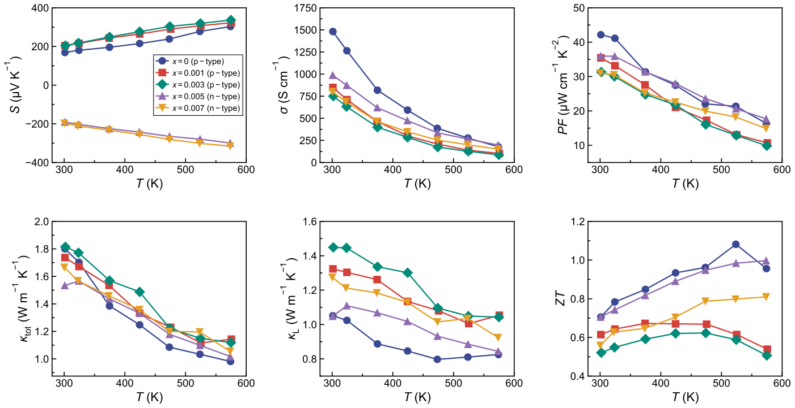<br />
  <sub><b>2×3 经典热电变温输运六联图</b> (<code>plot-te --plot-mode combined</code>：p→n 掺杂转变全参数 <i>S</i>, <i>σ</i>, <i>PF</i>, <i>κ</i><sub>tot</sub>, <i>κ</i><sub>L</sub>, <i>ZT</i>)</sub>
</p>

<table>
  <tr>
    <td align="center" width="50%">
      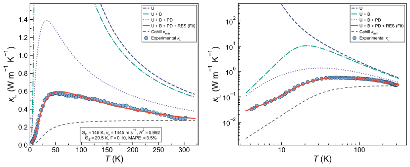<br />
      <sub><b>Debye–Callaway 模型拟合晶格热导率</b> (U + B + PD + RES)</sub>
    </td>
    <td align="center" width="50%">
      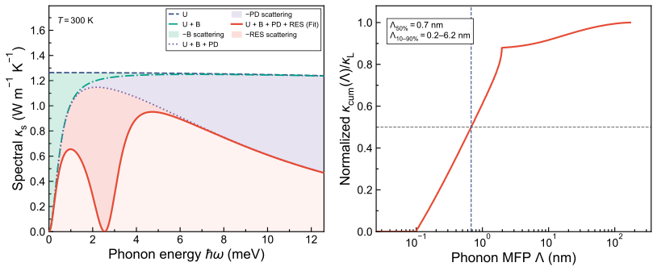<br />
      <sub><b>谱热导 κ<sub>s</sub>(ℏω) 与累积声子自由程 Λ<sub>50%</sub></b> (<code>callaway</code>)</sub>
    </td>
  </tr>
  <tr>
    <td align="center" width="50%">
      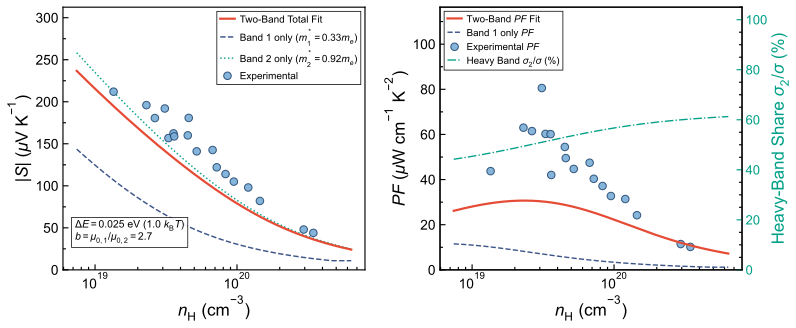<br />
      <sub><b>双价带收敛与重带电导权重演化</b> (<code>two-band --mode convergence</code>)</sub>
    </td>
    <td align="center" width="50%">
      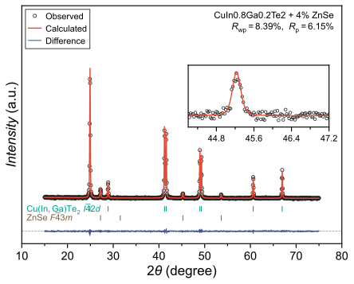<br />
      <sub><b>Rietveld 精修残差谱、Bragg 峰标与局部放大</b> (<code>plot-xrd --rietveld</code>)</sub>
    </td>
  </tr>
</table>

<table>
  <tr>
    <td align="center" width="33%">
      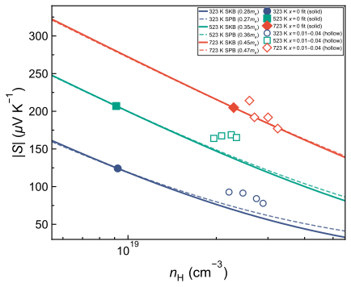<br />
      <sub><b>多温区非抛物 SKB vs SPB Pisarenko</b> (<code>skb</code>)</sub>
    </td>
    <td align="center" width="33%">
      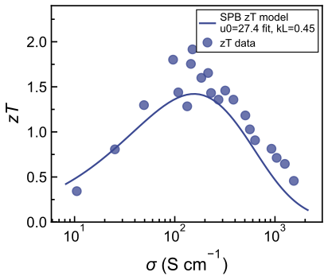<br />
      <sub><b>电导率轴 SPB zT(σ) 拟合</b> (<code>spb conductivity</code>)</sub>
    </td>
    <td align="center" width="33%">
      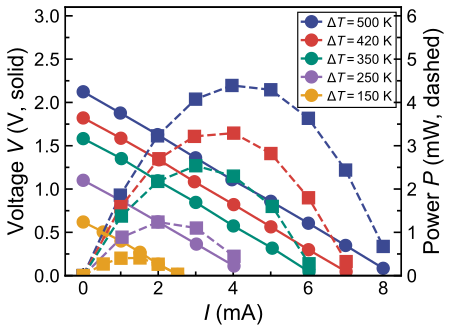<br />
      <sub><b>TEG 发电模组 I–V 与输出功率</b> (<code>sciplot</code>)</sub>
    </td>
  </tr>
  <tr>
    <td align="center" width="33%">
      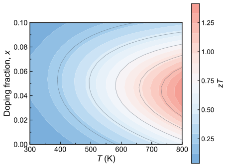<br />
      <sub><b>二维 (T, x) zT 等高线相图</b> (<code>sciplot</code>)</sub>
    </td>
    <td align="center" width="33%">
      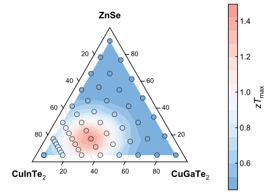<br />
      <sub><b>三元固溶成分热电优值相图</b> (<code>sciplot</code>)</sub>
    </td>
    <td align="center" width="33%">
      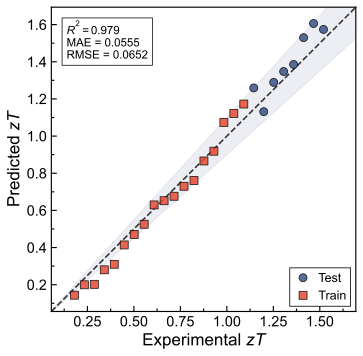<br />
      <sub><b>ML Parity 对角预测与 ±10% 误差带</b> (<code>sciplot</code>)</sub>
    </td>
  </tr>
</table>

---

## 安装指南与两种工作模式

### 1. 安装依赖与全局 CLI 命令

要求 **Python >= 3.10**。执行可编辑安装（或标准安装）后，系统会自动注册 `te`、`tedex`、`te-init`、`te-plot-te`、`te-plot-xrd`、`te-sciplot` 与 `te-spb-*` 命令行入口：

```bash
git clone https://github.com/<your-username>/tedex.git
cd tedex
pip install -r requirements.txt
pip install -e .
```

验证安装：

```bash
te --help
# （若未执行 pip install -e .，可在仓库根目录使用 python main.py --help）
```

### 2. 选择适合你的运行模式（支持 Antigravity / Claude Code / Codex / Cursor）

1. **形态 B —— 软件层独立插件 + 纯净用户数据目录 *（推荐）***：
   - 将 [`plugin/tedex`](plugin/tedex/README.md) 复制或软链接至 `~/.gemini/config/plugins/tedex`。
   - 直接打开**任意空白的实验项目文件夹**（例如 `D:/Research/CuInTe2_Project`），文件夹内仅存放 `configs/workspace.json`、`data/` 与 `outputs/`，不含任何 Python 源码或技能文件。
   - 首次使用时运行 `te init`（或直接让 AI Agent 引导初始化），确认各文件夹位置、子目录分组维度（`by_batch` / `by_system_batch` / `by_project`）及仪器与单位约定并固化下来。
2. **形态 A —— 一体化工作区仓库模式**：
   - 在 AI IDE 或终端中直接打开本仓库根目录，Agent 会自动读取 [AGENTS.md](AGENTS.md) / [CLAUDE.md](CLAUDE.md) 并按需加载 `.agents/skills/` 下的 5 个正交技能。

<p align="center">
  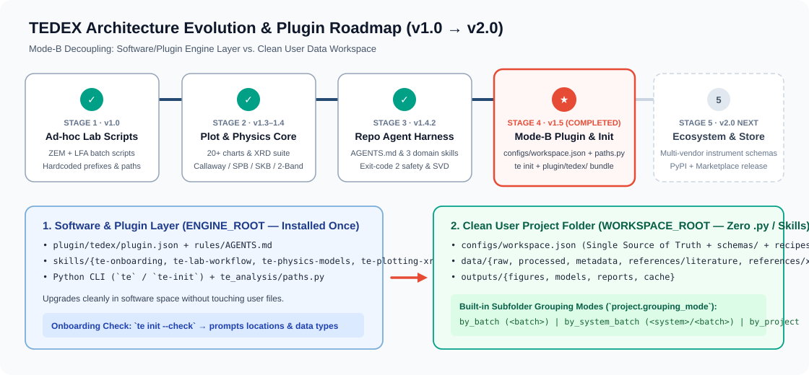
</p>

---

## 功能模块详解与完整 CLI 指令参考

以下所有指令既可在安装后于任意目录执行 **`te <子命令> ...`**，也可在本仓库根目录执行 **`python main.py <子命令> ...`**。在子命令前加 `-w / --workspace <目录>` 可显式指定外部数据工作区。

### 1. 工作区初始化与目录配置 (`init`)

在纯净文件夹中生成 [`configs/workspace.json`](configs/workspace_template.json)，自动创建数据与输出目录树及空白台账文件（`batches.json`、`samples.json`、`lab_metadata.md`），由 `te_analysis/paths.py` 作为全局唯一路径事实源。

```bash
# 检查当前文件夹是否已初始化（已初始化返回码 0；未初始化返回码 2 并打印待确认清单）
te init --check
te init --status --json

# 交互式向导（直接回车即采用默认目录结构）
te init

# 非交互式一键初始化：按“材料体系/批次”两级目录组织，并指向外部公共 XRD 标准卡片库
te init --yes \
  --name "CuInTe2 Doping Study" \
  --grouping by_system_batch \
  --batch-prefix "CIT" \
  --xrd-cards-dir "D:/SharedLab/XRD_PDF_Cards" \
  --xrd-radiation Cu-Ka \
  --formats svg png
```

| 常用参数 | 功能说明 |
| --- | --- |
| `--check` / `--status` / `--json` | 查看当前解析的完整目录与单位配置，不改动任何文件（未初始化时 `--check` 返回退出码 `2`）。 |
| `--grouping {by_batch,by_system_batch,by_project}` | 子目录命名拓扑：按批次 `<batch>`、按体系/批次 `<system>/<batch>` 或按课题项目 `<project>`。 |
| `--batch-prefix <PREFIX>` | 可选批次前缀缩写（如 `TE`、`SNSE`，留空 `""` 则保持自由命名）。 |
| `--raw-dir`, `--processed-dir`, `--metadata-dir`, `--xrd-cards-dir`, `--figures-dir`, `--models-dir`, `--reports-dir` | 自定义任意逻辑目录位置（同时支持相对路径与跨盘符绝对路径）。 |
| `--xrd-radiation` / `--xrd-wavelength` | 设定默认 XRD 靶材与波长（`Cu-Ka` `1.5406 Å`、`Mo-Ka` `0.71073 Å`、`Co-Ka` `1.78897 Å` 或自定义波长）。 |

---

### 2. 原始 ZEM + LFA 批处理、台账同步与贝叶斯预测 (`analyze`, `sync`, `assess`, `bayes`)

自动配对 `paths.raw` 下的电输运（`<sample_id>_ZEM.txt`）与热扩散系数（`<sample_id>_LFA.csv` 或 `.xlsx`）文件，读取 `lab_metadata.md` / `samples.json` 中的实测密度 `density` 与比热 `cp_value`，插值计算 $\sigma$、$S$、$PF$、$\kappa$、$zT$、SPB 洛伦兹数 $L$、$\kappa_{\mathrm{e}}$、$\kappa_{\mathrm{L}}$、加权迁移率 $\mu_{\mathrm{W}}$ 与品质因子 $B$，输出标准 CSV 与 `extracted_features.json`。

```bash
# 扫描原始数据目录并双向同步 JSON 台账与可编辑的 lab_metadata.md
te sync metadata
te sync markdown export      # JSON -> 导出可编辑的 lab_metadata.md 表格
te sync markdown import      # 将手动填写的密度/比热/组分从 lab_metadata.md 写回 JSON
te sync reference-xlsx --help
te sync notion-payload --help

# 运行单批次、指定样品或全量批次的原始数据清洗与特征提取
te analyze TE-1048
te analyze TE-1048 --sample A B
te analyze --all --dry-run

# 批次优化方向评估、高斯过程贝叶斯组分筛选与 AI 机理综述生成
te assess TE-1040 TE-1048
te bayes --target ZT_max --top 10 --pdf
te agent TE-1048 --matrix "CuInTe2"
```

---

### 3. 热电传输绘图与 20+ 种通用科研图表 (`plot-te`, `sciplot`)

#### 3.1 热电传输性质组图与单图 (`plot-te`)

支持按批次号、样品选择器、单个 CSV 或文件夹绘制 $S$、$\sigma$、$\rho$、$\kappa$、$\kappa_{\mathrm{e}}$、$\kappa_{\mathrm{L}}$、$PF$、$L$、$\mu_{\mathrm{W}}$、$B$ 与 $zT$。

```bash
# 导出 6 宫格总览图或指定物理量的独立高清图
te plot-te TE-1048 --plot-mode combined --formats svg png --no-show
te plot-te TE-1048 --seebeck --conductivity --pf --kl --zt --legend --no-show

# 跨批次同体系组分梯度对比（单色深浅渐变色阶）与对数/对称对数纵轴
te plot-te TE-1036-A TE-1040-A TE-1048-A --zt --legend --color-set blue --no-show
te plot-te data/demo/flexible_plotting/messy_te_temperature_series.csv --conductivity --yscale log --no-show
```

#### 3.2 20+ 种通用科研图型与 JSON 绘图配方 (`sciplot`，兼容旧别名 `flexible`)

既可通过 `--figure <图类型或模板名>` 命令行直出，也可加载 `configs/plot_recipes/` 下的 JSON 配方。详尽参数见 [docs/SCIPLOT.md](docs/SCIPLOT.md)。

| 图表大类 | 支持的 `--figure` / `--kind` 类型 |
| --- | --- |
| **一维、柱图与多轴** | `line`、`scatter`、`bar`、`grouped_bar`、`stacked_bar`、`percent_stacked_bar`、`waterfall`、`dual_axis`、`dual_line`、`multi_panel`、`broken_y`（断轴图）、`fit_residual`（拟合+残差双栏） |
| **二维场与多组元相图** | `heatmap`（矩阵热图）、`contour`（等高线相图，默认 `soft-br`）、`bubble`（四维气泡图）、`ternary`（三元成分相图） |
| **统计分布与机理诊断** | `boxplot`、`violin`、`histogram`（含正态/对数正态/KDE 核密度）、`parity`（预测 vs 实验对角误差带）、`arrhenius`（自动提取活化能 $E_{\mathrm{a}}$ + 顶部温度轴）、`radar`（多指标雷达图）、`benchmark`（文献对标背景散点） |
| **通用科研叠加层** | 误差棒/误差阴影带（`--yerr`、`--yerr-pct`、`--error-mode band`）、水平/垂直参考线与阴影区间（`--hline`、`--vline`、`--hspan`、`--vspan`）、画中画局部放大（`--inset-xlim`、`--inset-ylim`） |

```bash
# 使用内置模板或图类型命令行一键出图
te sciplot --figure contour_phase_map data/phase_grid.csv --xlim 300 800 --zlim 0 1.6 --formats svg png --no-show
te sciplot --figure ternary_composition data/comp.csv --alabel "CuInTe2" --blabel "CuGaTe2" --clabel "ZnSe" --no-show
te sciplot --figure parity_pred_vs_exp data/ml_pred.csv --formats svg png --no-show
te sciplot --figure arrhenius_conductivity data/sigma_T.csv --formats svg png --no-show

# 加载 JSON 配方并按渲染顺序将导出图片重命名为 [1].svg, [2].svg ...
te sciplot --recipe configs/plot_recipes/thermoelectric/temperature_vs_zt_benchmark.json --rename "[1]" --no-show
```

---

### 4. XRD 衍射谱图全集与晶胞参数精修 (`plot-xrd`, `xrd-lattice`)

支持 `.xy`、`.txt`、`.dat`、`.csv`、`.asc`、`.ras` 格式，支持上下双标准 PDF 卡片对比、8 种专业布局以及基于空间群对称性约束的 Bragg 倒易晶格精修。

```bash
# 标准多样品堆叠谱图、上下双 PDF 卡片对比及按序号筛选 (--pick)
te plot-xrd TE-1048 --pdf-card CuInTe2_PDF_97_023_8958 --formats svg png --no-show
te plot-xrd TE-1048 --pick 124 --both --no-show

# 主峰偏移局部放大双栏图 (--zoom)、原位变温二维相变热图 (--vt-map) 与温度梯度瀑布谱 (--vt-stack)
te plot-xrd TE-1048 --zoom 26.6 28.4 --pdf-card CuInTe2_PDF_97_023_8958 --no-show
te plot-xrd path/to/VT_XRD --vt-map --transition-temp 635 --formats svg png --no-show
te plot-xrd path/to/VT_XRD --vt-stack --guide-2theta 27.55 45.40 --no-show

# Rietveld 精修残差谱、伪 Voigt 重叠峰分峰拟合 (--peak-fit) 与 Williamson-Hall 晶粒/微应变拟合 (--wh)
te plot-xrd path/to/rietveld_profile.csv --rietveld --zoom 44.0 47.5 --formula "CuInTe2" --no-show
te plot-xrd TE-1048-A --peak-fit --xlim 44.2 46.8 --max-peaks 3 --no-show
te plot-xrd TE-1048-A --wh --pdf-card CuInTe2_PDF_97_023_8958 --instr-fwhm 0.05 --no-show

# 从实测 XRD 与标准卡片精修晶胞参数 (a, b, c, alpha, beta, gamma)
te xrd-lattice --pdf-card "data/pdf_card/CuInTe2 PDF#97-023-8958.txt" --xrd data/demo/xrd/a.xy --sample-name Demo_A
```

---

### 5. 声子与电子能带输运物理建模套件 (`model`, `spb`, `band`)

所有物理模型统一导出高清矢量图、实验点与理论光滑曲线 CSV、双单位制文献对照 Markdown 报告，以及含 SVD 雅可比条件数、标准误、95% 置信区间和参数相关性矩阵的 `*_summary.json`。

#### 5.1 声子散射、德拜参数与低温比热 (`debye-calc`, `callaway`, `debye-einstein`)

> **缺参防呆机制（退出码 `2`）**：当未提供必需的晶格常数（如德拜温度 $\Theta_{\mathrm{D}}$ 与声速 $v_{\mathrm{s}}$）时，`callaway` 与 `debye-calc` 会以状态码 **`2`** 安全退出并打印 3 套实验参数输入方案清单（直接输入、超声纵横波速或低温比热斜率），绝不盲猜物性常数。

```bash
# 1. 由超声脉冲回波波速 (vl, vt) 或低温比热拟合德拜温度 Theta_D、Anderson 声速 v_s、弹性模量与 Gruneisen 常数
te debye-calc --vl 3100 --vt 1750 --atomic-volume-a3 29.0
te debye-calc --cp-csv data/demo/physics_fitting/cp_rattler.csv --atoms-per-fu 4 --atomic-volume-a3 29.2

# 2. 多源声子散射 Debye-Callaway 晶格热导率拟合、散射率权重拆解 S_m(T)、谱热导 kappa_s 与累积自由程 MFP
#    支持机制：U (Umklapp), B/GB (晶界), PD (点缺陷), EP (电声/面缺陷),
#             D (位错核心+应变场), NP (纳米析出相), RES/R (笼状局域共振；TE 拟合共振温度 Theta_E)
te callaway data/demo/physics_fitting/paper_demo_kl_4_300K.csv \
  --theta-d 146 --vs 1445 \
  --mechanisms U B PD RES --fit U PD RES TE \
  --grain-size-nm 80 --spectral-xaxis meV --formats svg png --no-show

# 3. 低温比热 Cp(T)/T^3 Sommerfeld 电子项 + Debye 晶格项 + 多阶 Einstein 局域振子玻色峰拟合
te debye-einstein data/demo/physics_fitting/cp_rattler.csv \
  --atoms-per-fu 4 --n-einstein 2 --volume-a3-per-fu 116.8 --formats svg png --no-show
```

#### 5.2 电子能带输运建模 (`spb`, `skb`, `two-band`)

```bash
# 1. 单抛物带模型 (SPB)：Pisarenko 态密度有效质量 m*、无霍尔数据的 S-sigma 迁移率拟合及 PF/zT(nH) 预测
te spb effective-mass data/demo/spb_fitting/Ag2Se/Ag2Se_series.csv --group-by curve_id --params data/demo/spb_fitting/Ag2Se/Ag2Se_params.csv --no-show
te spb conductivity data/demo/spb_fitting/Cu2SSeTe/900K.csv --sigma-unit S/cm --kL 0.5 --no-show
te spb performance data/demo/spb_fitting/Ag2Se/Ag2Se_series.csv --group-by curve_id --params data/demo/spb_fitting/Ag2Se/Ag2Se_params.csv --kL 0.5 --no-show

# 2. 非抛物单 Kane 带模型 (SKB)：窄带隙半导体 (alpha = k_B T / E_g) 有效质量、洛伦兹数与形变势 Xi 提取
te skb data/demo/physics_fitting/skb_narrow_gap.csv --temperature 300 --eg 0.25 --kL 0.6 --formats svg png --no-show

# 3. 双能带输运模型 (Two-Band)：
#    --mode convergence : 恒温轻带+重带收敛随载流子浓度演化（拟合 m*1, m*2, 能谷劈裂 Delta_E, 迁移率比 b）
#    --mode bipolar     : 变温多数/少数载流子本征激发与双极扩散热导率 kappa_bi(T) 分离
#    --mode semimetal   : 半金属/负带隙/极窄带隙材料霍尔符号反演与跨相区全局拟合（如 Mg3Bi2 基）
te two-band data/demo/physics_fitting/two_band_convergence.csv --mode convergence --temperature 300 --fix-m1 0.35 --no-show
te two-band data/demo/physics_fitting/two_band_bipolar.csv --mode bipolar --no-show
te two-band data/demo/physics_fitting/two_band_semimetal_mg3bi2.csv --mode semimetal --fix-m1 0.530 --fix-m2 0.276 --no-show
```

---

### 6. 全工具通用绘图与控制参数

| 通用参数 | 适用范围 | 作用说明 |
| --- | --- | --- |
| `--no-show` | 全部绘图与物理建模命令 | 无头模式保存文件，不弹出 GUI 窗口（批处理与 AI Agent 调用必加）。 |
| `--formats svg png pdf` / `--pdf` | 全部绘图与物理建模命令 | 一次运行同步导出多种矢量（`svg`、`pdf`）或位图（`png`）格式。 |
| `--color-set <NAME>` | `plot-te`、`plot-xrd`、`sciplot`、`spb`、物理模型 | 色板预设：`science` *（默认）*、`npg`、`classic`、`blue-orange`、`blue`、`teal`、`purple`、`orange`、`red`、`gray`、`legacy`。详见 [COLOR_SETS.md](docs/COLOR_SETS.md)。 |
| `--rename "[1]"` 或 `"FigA"` | 全部绘图与物理建模命令 | 按实际出图顺序将文件主干重命名为 `[1].svg`、`[2].svg` ... 详见 [COMMANDS.md](docs/COMMANDS.md#rename-exported-figures)。 |
| `--legend {inside,outside,none}` | `plot-te`、`sciplot`、`spb` | 默认为 `inside`，自动计算最低碰撞方位并扩展坐标轴留白。 |
| `-w`, `--workspace <DIR>` | 顶层 `te` / `main.py` | 显式指定目标 Mode-B 用户数据目录运行任意子命令。 |

---

## AI Agent 5 大正交技能与仓库结构

TEDEX 将领域工作流拆分为 **5 个职责正交的按需技能**，同时存放在工作区 `.agents/skills/` 与独立软件层插件包 `plugin/tedex/skills/` 中：

| 技能名称 | 负责领域 |
| --- | --- |
| [`te-workspace`](.agents/skills/te-workspace/SKILL.md) | 新课题初始化（`te init`）、`configs/workspace.json` 目录映射、分组拓扑与仪器单位配置。 |
| [`te-data-pipeline`](.agents/skills/te-data-pipeline/SKILL.md) | 原始 ZEM/LFA 处理（`analyze`）、`lab_metadata.md` ↔ JSON 双向同步（`sync`）、`assess`、`bayes` 及致密度核查守则。 |
| [`te-plotting`](.agents/skills/te-plotting/SKILL.md) | `plot-te` 热电性质绘图、`sciplot` 20+ 种科研图型与 JSON 配方、通用叠加层、配色与 `--rename`。 |
| [`te-xrd`](.agents/skills/te-xrd/SKILL.md) | `plot-xrd`（堆叠、局部放大、变温热图/瀑布图、Rietveld、分峰、W–H）标准卡对比与 `xrd-lattice` 晶胞精修。 |
| [`te-physics-models`](.agents/skills/te-physics-models/SKILL.md) | `debye-calc`、`callaway`、`debye-einstein`、`spb`、`skb`、`two-band` 物理建模、缺参清单与共线性消解。 |

```text
tedex/
├── main.py                  # 根目录启动器薄封装 -> te_analysis.launcher:main
├── te_analysis/             # 自包含可安装 Python 包 (tedex)
│   ├── paths.py             # ENGINE_ROOT 与 WORKSPACE_ROOT 统一路径解析引擎
│   ├── launcher.py          # 统一命令分发器 (`te` / `tedex`)
│   ├── pipeline/            # analyze, assess, bayes, agent_analysis
│   ├── sync/                # metadata, markdown, notion_payload, reference_xlsx
│   ├── plotstyle/           # 出版级字号与坐标轴格式化
│   └── tools/               # workspace_init, te_plotting, sciplot, xrd, spb, physics, legend_layout
├── plugin/tedex/            # 形态 B 独立插件包 (plugin.json, rules/, 5 大 skills/)
├── .agents/skills/          # 工作区级 5 大正交 AI 技能
├── configs/                 # workspace_template.json, plot_recipes/, sciplot_demos/
├── data/                    # 公开 demo/ 与 pdf_card/ 示例集（私有实验目录已由 .gitignore 保护）
├── showcase/                # 8 大端到端实战案例库 + 单文件静态网页预览 preview.html
├── docs/                    # COMMANDS.md, SCIPLOT.md, COLOR_SETS.md, PROJECT_STRUCTURE.md, RELEASING.md
└── tests/                   # 60+ 项单元、黄金基准、物理精度与 Mode-B 纯净工作区回归测试
```

可随时运行 `pytest tests/` 或 `python tests/run_tests.py` 执行完整测试套件。

## 开源许可

本项目基于 [MIT License](LICENSE) 开源发布。
