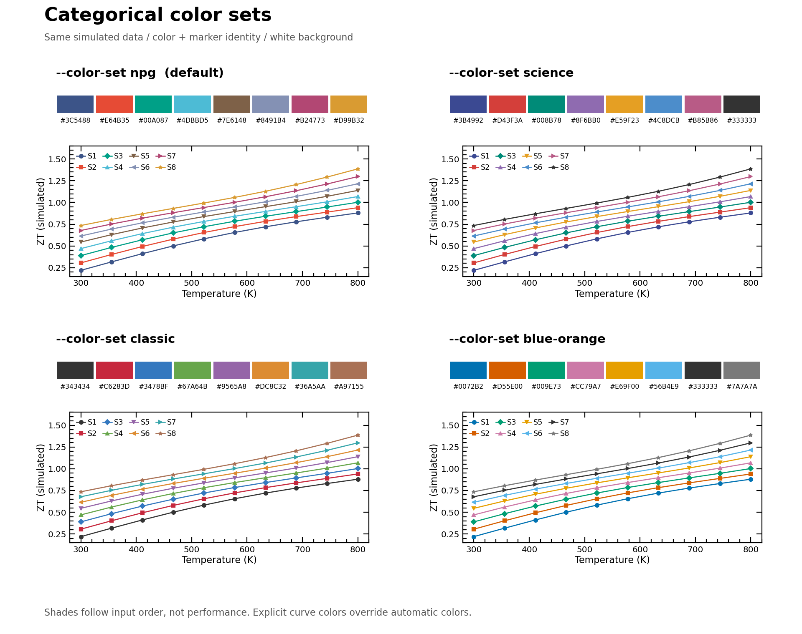
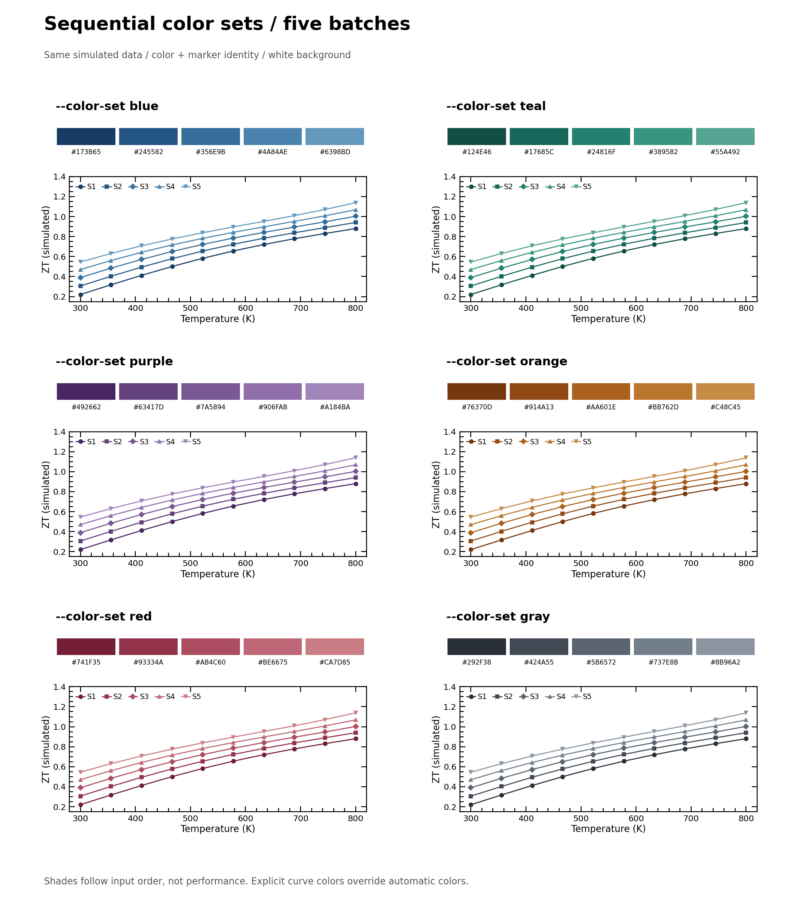
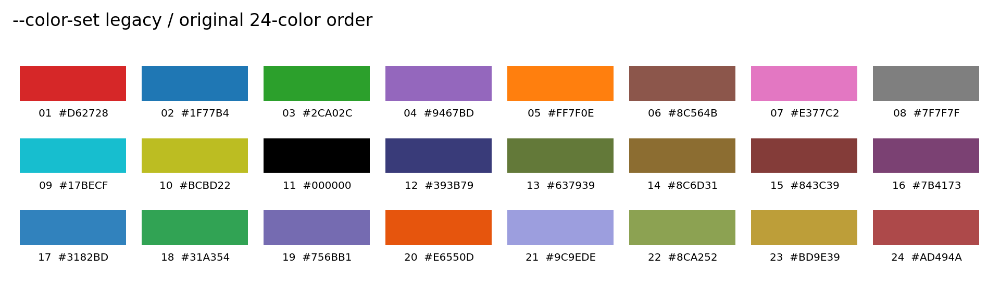

# 绘图配色：`--color-set`

`python main.py plot-te`、`plot-xrd`、`sciplot` 和三个 `spb` 拟合命令均支持
`--color-set NAME`。自动配色默认使用 **`science`（深蓝靛 × 胭脂红高对比学术色系）**。
已有 recipe 中明确指定的曲线颜色仍然有效；没有指定颜色的曲线才使用自动配色。
恢复原有 24 色顺序请使用 `--color-set legacy`。

## 快速选择

| 名称 | 配色 | 用途 |
| --- | --- | --- |
| `science` | 深色高对比，8 色，**默认** | 多样品、多成分鲜明对比 |
| `npg` | 珊瑚红 × 海蓝，8 色 | 柔和期刊多色对比 |
| `classic` | 黑、红、蓝、绿起始，8 色 | 经典材料论文图，首个样品可作为基准 |
| `blue-orange` | 蓝橙优先，8 色 | 蓝、朱橙、青绿、紫红搭配 |
| `blue` | 深海蓝渐变 | 同一成分的不同批次 |
| `teal` | 青玉绿渐变 | 同一成分的不同批次 |
| `purple` | 鸢尾紫渐变 | 同一成分的不同批次 |
| `orange` | 琥珀橙渐变 | 同一成分的不同批次 |
| `red` | 胭脂红渐变 | 同一成分的不同批次 |
| `gray` | 石墨灰渐变 | 单色、基准或辅助比较 |
| `legacy` | 原有 24 色 | 复现之前的配色顺序 |

这里使用简短名称 `blue`，不是设计预览阶段的 `mono-blue`；`npg` 也取代了预览名称 `npg-refined`。

## 多色方案预览



所有曲线均为模拟数据，只展示配色效果。色卡与程序共用
[`colors.py`](../te_analysis/tools/colors.py) 中的定义。

```bash
# 不写 --color-set 时，自动配色默认使用 science
python main.py plot-te TE-1048 --zt --legend --no-show
python main.py plot-te TE-1048 --zt --legend --color-set npg --no-show
python main.py plot-te TE-1048 --zt --legend --color-set classic --no-show
python main.py plot-te TE-1048 --zt --legend --color-set legacy --no-show
```

## 同一成分、不同批次：使用同色系渐变



渐变按输入/加载后的样品顺序由深到浅分配，**不按性能高低排序**，也不会自动推断样品的化学成分或实验日期。
请按需要的批次顺序列出样品选择器或 CSV 路径；目录内部顺序遵循现有加载规则。

- 1 个样品：使用最深色。
- 2 个样品：使用最深色和最浅色。
- 3 个样品：使用深、中、浅三色。
- 5 个样品：使用图中完整五色。
- 其他数量：在这五个锚点之间插值，并覆盖整个深浅范围；不会在第五个样品之后重新从深色循环。

符号也会变化以辅助辨识。建议同色系主要用于 3–5 个批次；批次更多时，相邻色差会缩小。
改变选中样品数量或顺序会重新分配颜色；若要跨不同选集永久固定颜色，可在 flexible recipe 中明确指定 `color`。

下面只是选择器示例，请替换成**你确认属于同一成分**的批次样品：

```bash
python main.py plot-te TE-1036-A TE-1040-A TE-1048-A --zt --legend --color-set blue --no-show
python main.py plot-te TE-1036-A TE-1040-A TE-1048-A --seebeck --conductivity --zt --legend --color-set teal --no-show
```

同一选集在各性能图/组合图中使用相同颜色和符号；某个样品缺少某项数据时，其余样品的颜色不会前移。

## XRD

```bash
python main.py plot-xrd TE-1056-B --color-set purple --no-show
python main.py plot-xrd TE-1056-B --color-set legacy --no-show
```

渐变根据筛选后的 XRD 曲线数量生成。堆叠图、单独图、原始强度与归一化图保持同一选集的样品配色。
PDF 标准卡的颜色仍由 `--standard-color` / `--top-standard-color` 单独控制。

## `--color-set` 与 `--color` 的区别

- `--color-set`：选择整套自动配色。
- `--color`：保留 XRD 和 flexible 原有的具体颜色设置，可写颜色名或十六进制颜色。
- 两者同时使用时，明确指定的 `--color` 优先；`--color blue` 仍表示纯蓝色，**不是蓝色渐变**。
- flexible 中单个 `--color` 应用于所有系列，重复使用则依次对应各系列。
- XRD 中重复的 `--color` 组成自定义循环。
- `plot-te` 没有新增单条曲线的 `--color` 参数，使用 `--color-set` 即可。

```bash
python main.py sciplot sample.csv --x Temperature --y ZT --color-set blue --no-show
python main.py sciplot sample.csv --x Temperature --y ZT --color-set npg --color "#173B65" --no-show
python main.py plot-xrd TE-1056-B --color-set npg --color "#173B65" --color "#6398BD" --no-show
```

## 在 flexible JSON recipe 中保存配色

在现有 recipe 的 `plot` 中增加 `color_set`：

```json
{
  "plot": {
    "kind": "multi_panel",
    "color_set": "blue"
  }
}
```

上面是**配置片段**，仍需保留原 recipe 的数据来源和列定义。命令行 `--color-set`
可以覆盖 recipe 的 `plot.color_set`；未传该参数时保留 recipe 的设置。
折线、散点、多面板、柱状图、分组柱状图和双轴图均可使用。
同组样品在多属性图中保持自动颜色/符号一致；系列显式 `color` 优先。

```bash
python main.py sciplot --recipe configs/plot_recipes/thermoelectric/temperature_vs_zt.json --color-set blue --no-show
```

### 同图中“色系表示成分，深浅表示批次”

一次 `--color-set` 选择一套颜色，不会自动按成分分配多个色系。
需要混合多个色系时，可用 flexible 的显式系列颜色。例如下面六个文件按
成分 A 的三个批次、成分 B 的三个批次排列：

```bash
python main.py sciplot A_batch1.csv A_batch2.csv A_batch3.csv B_batch1.csv B_batch2.csv B_batch3.csv --x Temperature --y ZT --color "#173B65" --color "#356E9B" --color "#6398BD" --color "#76370D" --color "#AA601E" --color "#C48C45" --marker o --marker s --marker D --marker o --marker s --marker D --no-show
```

这样成分 A 使用蓝色，成分 B 使用橙色，每个成分内部三个批次分别为深、中、浅，符号重复对应批次。
也可将这些 `color` 和 `marker` 写入 recipe 的各个 `plot.series` 条目中，避免每次输入长命令。

## SPB 拟合图

三个 SPB 命令也接受 `--color-set`；拟合数值计算不受影响。多组曲线按组数量取色，
实验点与对应模型按现有分组顺序配对。显式选择 `--color-set` 时也应用于单组模型/数据。
未指定时，单组拟合中已有 recipe 的固定颜色按原逻辑保留；自动分组颜色默认为 `npg`。

```bash
python main.py spb effective-mass data/demo/spb_fitting/Ag2Se/Ag2Se_series.csv --group-by curve_id --params data/demo/spb_fitting/Ag2Se/Ag2Se_params.csv --color-set blue --no-show
```

## 原有默认配色



前八色为红、蓝、绿、紫、橙、棕、粉、灰；第 11 色是黑色。
类别色板超过自身长度后循环，符号继续变化。旧方案可通过 `--color-set legacy` 选择。

## 设计来源与维护

这些是项目配色，不是期刊统一规定或官方认证的色板。

- `npg`：参考 [ggsci NPG](https://nanx.me/ggsci/reference/pal_npg.html)，重排并调整扩展色。
- `science`：参考 [ggsci AAAS](https://nanx.me/ggsci/reference/pal_aaas.html)，调整红色和扩展色。
- `classic`：参考 [Nature Materials 热电输运图](https://www.nature.com/articles/s41563-024-01815-1/figures/3)，重新选色并扩展。
- 设计也参考 [Nature 绘图规范](https://research-figure-guide.nature.com/figures/preparing-figures-our-specifications/) 对可辨识性、坐标与标签的建议。

配色源文件：[`te_analysis/tools/colors.py`](../te_analysis/tools/colors.py)。修改色值后可重新生成本页图片：

```bash
python scripts/plotting/preview_color_sets.py
```
