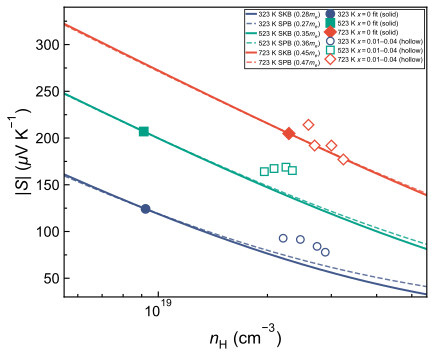
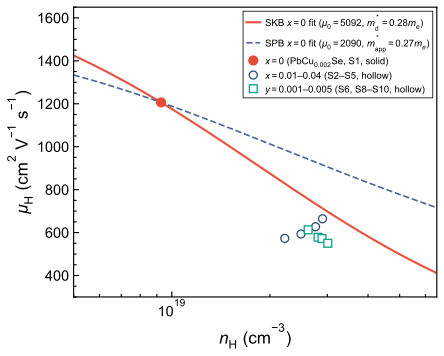
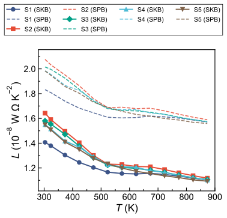
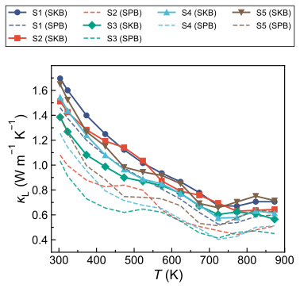

# Case 01: PbSe 窄带隙非抛物单 Kane 带（SKB）与单抛物带（SPB）多温区对比
> **Multi-Temperature Non-Parabolic SKB vs. SPB Transport in Narrow-Gap PbSe**

- **Category**: `Electronic Band Physics`
- **Skills Used**: `te-physics-models`, `te-plotting`
- **Material System**: n-type PbSe (303–723 K)
- **Benchmark / Reference**: Narrow-gap IV–VI lead chalcogenide Hall + Seebeck benchmark

## 1. User Prompt (自然语言任务指令)

> 对 PbSe 体系做 323 / 523 / 723 K 多温区 Pisarenko 拟合与 303 K 迁移率 μ_H(n_H) 分析，对比非抛物单 Kane 带（SKB, r_H=1 与含 r_H）和传统单抛物带（SPB）的有效质量 m*_d、本征迁移率 μ_0，以及由两种模型扣除电子热导 κ_e 后得到的晶格热导 κ_L(T) 差异；用实心点标出 x=0 基体，空心点标出固溶系列。

## 2. Agent Execution Highlights (Agent 核心推理与防呆亮点)

- 自动调用 `skb`（`--no-hall-factor` / 含 Kane 霍尔因子）与 `spb effective-mass` 对 323/523/723 K 基体逐温拟合，量化窄带隙（E_g ≈ 0.27 eV, N_v = 4）非抛物性因子 α = k_B T / E_g 随温度的增强。
- 在 303 K 下揭示传统 SPB 将非抛物重化归入表观质量导致 μ_0 被低估（2090 vs SKB 5092 cm² V⁻¹ s⁻¹），并准确复现高掺杂区的更陡迁移率衰减斜率。
- 通过 `sciplot` Recipe 一键组合实心（x=0 拟合组）与空心（x>0 固溶验证组）散点及实虚线双模型理论曲线，并对比 Lorenz 数 L(T) 与 κ_L(T) 扣除偏差。

## 3. Reproducible CLI Commands (可复现命令)

```bash
python main.py skb showcase/cases/01_pbse_nonparabolic_skb_vs_spb/data/rt_303K_x0_full.csv -T 303 --eg 0.271 --nv 4 --no-hall-factor --formats svg png --no-show
python main.py sciplot --recipe showcase/cases/01_pbse_nonparabolic_skb_vs_spb/recipes/pisarenko_x0_solid_hollow.json --no-show
python main.py sciplot --recipe showcase/cases/01_pbse_nonparabolic_skb_vs_spb/recipes/rt_mobility_x0_linear.json --no-show
```

## 4. Key Quantitative Metrics (核心定量指标)

| Metric | Value |
| --- | --- |
| Bandgap E_g (303 K) | `0.271 eV (α = 0.096)` |
| SKB m*_d (323→723 K) | `0.28 → 0.35 → 0.45 m_e` |
| 303 K μ_0 (SKB vs SPB) | `5092 vs 2090 cm² V⁻¹ s⁻¹` |
| 303 K RMSE(μ_H) | `97.7 (SKB) vs 139.0 (SPB) cm² V⁻¹ s⁻¹` |

## 5. Publication Figures (生成图表)

### 323 / 523 / 723 K 多温区 Pisarenko（SKB 实线 vs SPB 虚线，x=0 实心 / 固溶空心）


### 303 K 室温 Hall 迁移率 μ_H(n_H) 非抛物声学散射对比


### SKB vs SPB 变温 Lorenz 数 L(T) 对比（S1–S5）


### SKB vs SPB 扣除电子热导后的晶格热导率 κ_L(T) 差异

