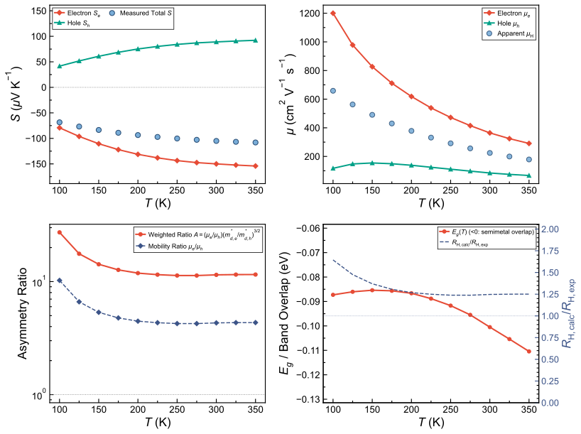
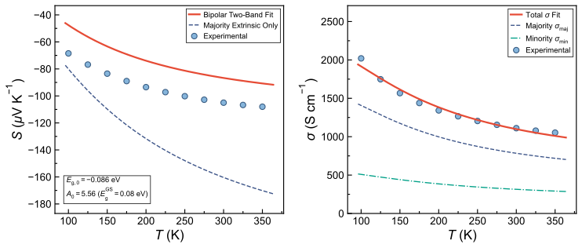
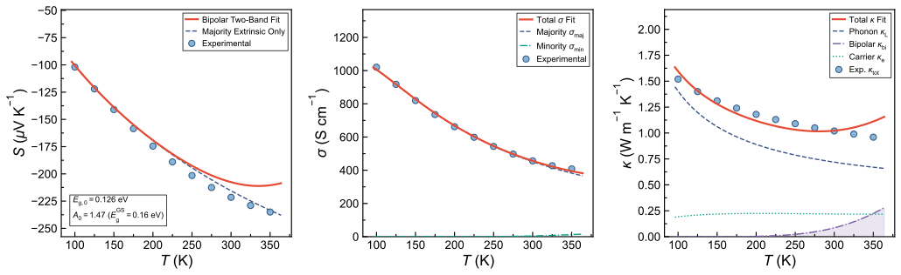
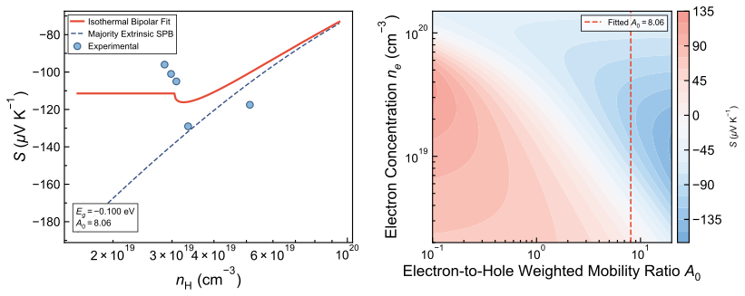

# Case 02: Mg3+δBi2-xSbx 半金属—窄带隙半导体跨相区双带输运反演与全局拟合
> **Semimetal-to-Semiconductor Crossover Two-Band Inversion & Bipolar Transport in Mg3+δBi2-xSbx**

- **Category**: `Semimetal & Bipolar Physics`
- **Skills Used**: `te-physics-models`
- **Material System**: Mg3.2Bi2-xSbxTex (x = 0, 0.3, 0.5; 100–350 K)
- **Benchmark / Reference**: Mao et al., PNAS / Science (2019) Mg3Bi2-based thermoelectric cooling benchmark

## 1. User Prompt (自然语言任务指令)

> 用 two-band 模块复现 Mg3.2Bi2-xSbx 体系从半金属（x=0, 负带隙重叠 E_g < 0）到近室温制冷窄带隙半导体（x=0.3, 0.5）的双带电子+空穴输运分析：包括半金属逐点 Hall+S+σ 反演、Matthiessen 杂质+声学散射全局负带隙拟合、x=0.5 制冷腿材料的热导三部分分解（κ_L + κ_e + κ_bi），以及 300 K 等温双极 Pisarenko 与加权迁移率比 A_0 图谱。

## 2. Agent Execution Highlights (Agent 核心推理与防呆亮点)

- 支持 `E_g < 0` 能带交叠半金属物理，当固定 DFT 态密度有效质量（m*_e = 0.53 m_e, m*_h = 0.276 m_e）时，逐点严格反演出 300 K 下 E_g = -0.100 eV、分带 Seebeck（S_e = -150.0, S_h = +89.0 μV K⁻¹）及加权迁移率比 A = 11.5。
- 通过 `--mode bipolar --allow-semimetal --matthiessen --fit-nh` 实现低温电离杂质散射到室温声学散射平滑过渡的全局联合拟合（33–44 个观测自由度）。
- 自动执行 SVD 雅可比条件数与协方差矩阵诊断，主动预警 κ_L = A/T + κ_∞ 中 A 与 κ_∞ 在窄温区下的强共线性（r = -0.925），提示引入独立表征固定参数。

## 3. Reproducible CLI Commands (可复现命令)

```bash
python main.py two-band showcase/cases/02_mg3bi2_semimetal_bipolar_suite/data/Mg3_2Bi2_semimetal.csv --mode semimetal --fix-m1 0.53 --fix-m2 0.276 --fix-ndop 0 --formats svg png --no-show
python main.py two-band showcase/cases/02_mg3bi2_semimetal_bipolar_suite/data/Mg3_2Bi2_semimetal.csv --mode bipolar --allow-semimetal --matthiessen --fit-nh --fix-m1 0.53 --fix-m2 0.276 --fix-ndop 0 --formats svg png --no-show
python main.py two-band showcase/cases/02_mg3bi2_semimetal_bipolar_suite/data/Mg3_2Bi1_498Sb0_5Te0_002.csv --mode bipolar --matthiessen --fit-nh --fix-m2 0.276 --fix-eg0 0.126 --fix-ndop 1.32e19 --formats svg png --no-show
python main.py two-band showcase/cases/02_mg3bi2_semimetal_bipolar_suite/data/Mg3Bi2_Te_300K_series.csv --mode isothermal-bipolar -T 300 --scattering-r 0.0 --fix-m1 0.53 --fix-m2 0.276 --fix-eg0 -0.10 --fix-b 0.33 --formats svg png --no-show
```

## 4. Key Quantitative Metrics (核心定量指标)

| Metric | Value |
| --- | --- |
| Mg3.2Bi2 Semimetal E_g(300K) | `-0.100 eV (band overlap)` |
| Partial Seebeck @ 300 K | `S_e = -150.0, S_h = +89.0 μV K⁻¹` |
| Weighted Mobility Ratio A | `A(x=0) = 11.5 → A_0(x=0.5) = 1.47` |
| x=0.5 Cooling Leg RMSE(S) | `11.4 μV K⁻¹ (E_g0 = +0.126 eV)` |

## 5. Publication Figures (生成图表)

### Mg3.2Bi2 半金属逐点 Hall+S+σ 反演（分带 S_{e,h}, μ_{e,h}, E_g(T)）


### Mg3.2Bi2 负带隙全局双极拟合（E_g0 = -0.092 ± 0.002 eV, Matthiessen 散射）


### Mg3.2Bi1.5Sb0.5Te0.002 近室温制冷材料全局双极拟合与 κ_bi 分解


### 300 K 等温双极 Pisarenko 与加权迁移率比 A_0 分布图

