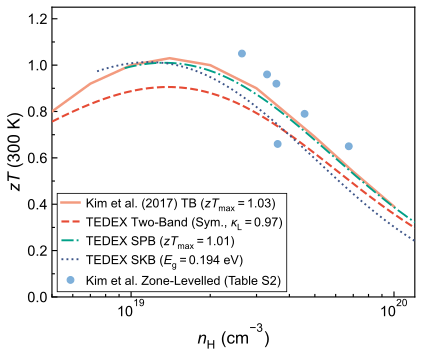
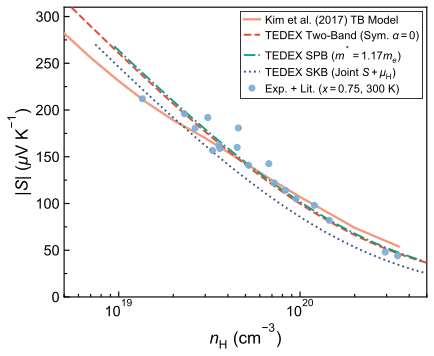
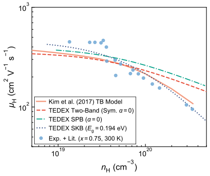
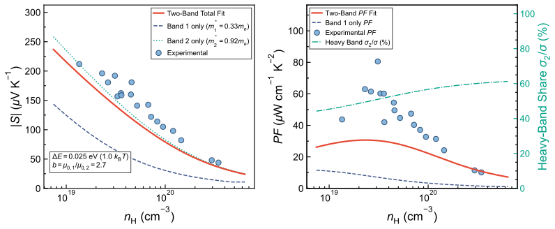
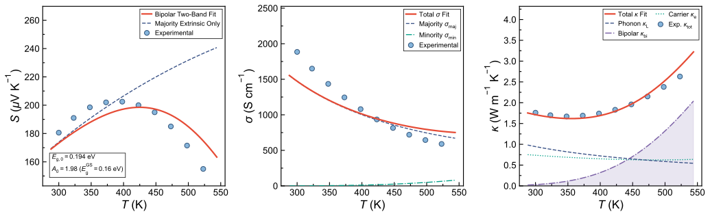

# Case 03: p-Bi0.5Sb1.5Te3 双价带收敛与多模型（SPB / SKB / Two-Band）基准对比
> **Light + Heavy Valence Band Convergence & Multi-Model Benchmark in p-Bi0.5Sb1.5Te3**

- **Category**: `Band Convergence Modeling`
- **Skills Used**: `te-physics-models`, `te-plotting`
- **Material System**: p-type Bi2-xSbxTe3 (x = 0.75, 300–500 K)
- **Benchmark / Reference**: Kim et al., Acta Materialia / J. Mater. Chem. A (2017) Zone-Levelled Bi0.5Sb1.5Te3

## 1. User Prompt (自然语言任务指令)

> 针对 p 型 Bi0.5Sb1.5Te3 体系（300 K 等温掺杂系列与变温双极数据），同时运行 SPB、SKB 与 Two-Band（轻重价带收敛 ΔE = 0.025 eV）模型，对比它们对高载流子浓度区 Pisarenko 平台、Hall 迁移率与峰值 zT 预测曲线的差异，并与原论文曲线直接叠图对比。

## 2. Agent Execution Highlights (Agent 核心推理与防呆亮点)

- 利用 `two-band --mode convergence` 解析轻价带（m*_1 = 0.326 m_e）与重价带（m*_2 = 0.916 m_e, ΔE = 25 meV）协同输运，准确捕捉高 n_H 下的 Seebeck 抬升与功率因子展宽。
- 结合 `two-band --mode bipolar` 提取高温少数载流子热激发引起的双极热导率 κ_bi(T) 峰值。
- 自动生成与文献原图同坐标系的四曲线对比图（原论文 TB vs TEDEX Two-Band vs SPB vs SKB），图例自动内嵌于坐标轴空白区。

## 3. Reproducible CLI Commands (可复现命令)

```bash
python main.py two-band showcase/cases/03_bi2sbte3_two_band_convergence/data/kim2017_x075_full300K_pf.csv --mode convergence -T 300 --fix-m1 0.326 --fix-m2 0.916 --fix-delta-e 0.025 --formats svg png --no-show
python main.py two-band showcase/cases/03_bi2sbte3_two_band_convergence/data/kim2017_x075_2.64E19_bipolar.csv --mode bipolar --fix-m1 1.14 --fix-m2 0.78 --fix-eg0 0.194 --formats svg png --no-show
python main.py sciplot --recipe showcase/cases/03_bi2sbte3_two_band_convergence/recipes/kim2017_zt_compare.json --no-show
```

## 4. Key Quantitative Metrics (核心定量指标)

| Metric | Value |
| --- | --- |
| Valence Band Offset ΔE | `0.025 eV (m*_1=0.33, m*_2=0.92 m_e)` |
| Peak zT (300 K) | `1.03 (Paper TB) vs 1.01–1.02 (TEDEX)` |
| Optical / Bipolar Bandgap E_g0 | `0.194 eV` |

## 5. Publication Figures (生成图表)

### 300 K zT(n_H) 四模型预测曲线对比（Paper TB vs TEDEX Two-Band / SPB / SKB）


### 300 K Pisarenko |S|(n_H) 轻重带收敛与单带对比


### 300 K Hall 迁移率 μ_H(n_H) 多模型对比


### TEDEX Two-Band 轻重价带收敛联合拟合（S 与 PF vs n_H）


### TEDEX Two-Band 变温双极热激发与 κ_bi 分解

