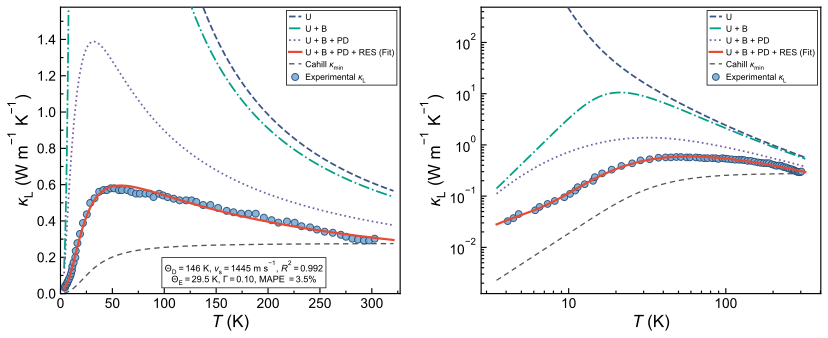
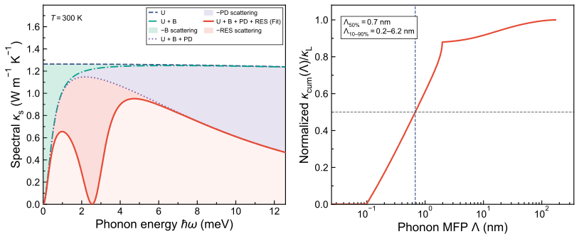
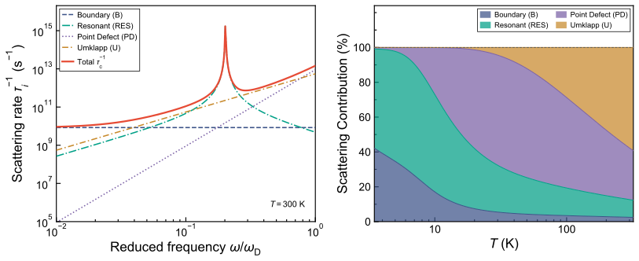
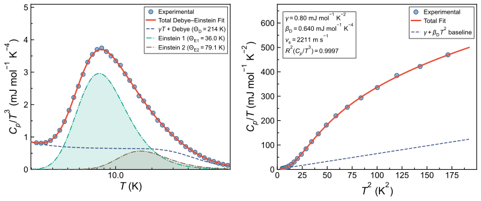

# Case 04: 4–300 K 晶格热导率 Debye–Callaway 局域共振散射与低温比热玻色峰解析
> **Cryogenic-to-300 K Debye–Callaway Rattler Scattering, Spectral MFP & Cp/T³ Boson Peak**

- **Category**: `Phonon Transport & Heat Capacity`
- **Skills Used**: `te-physics-models`
- **Material System**: Rattler Chalcogenide / Cage-like Thermoelectric (4–300 K)
- **Benchmark / Reference**: Debye–Callaway U+B+PD+RES & Sommerfeld–Debye–Einstein low-T Cp benchmark

## 1. User Prompt (自然语言任务指令)

> 对 4–300 K 全温区晶格热导率数据拟合 Debye–Callaway 模型（包含 Umklapp、晶界 B、点缺陷 PD 和局域共振模 RES），输出阶梯累积曲线、以 meV 为横轴的谱热导 κ_s(ħω) 与累积平均自由程 Λ_50%、顺序无关散射份额 S_m(T) 以及双单位 Markdown 报告；同时用 debye-einstein 对低温比热 Cp/T³ 玻色峰拟合 Einstein 局域振动模温度。

## 2. Agent Execution Highlights (Agent 核心推理与防呆亮点)

- 若用户未给 Θ_D 与 v_s，`callaway` 以退出码 `2` 终止并列出 3 种物理参数提供路径（直接输入、超声纵向/横向声速 v_l/v_t、低温比热斜率 β），杜绝 AI 编造物理常数。
- 全温区拟合优度 R² = 0.9918（RMSE = 0.0153 W m⁻¹ K⁻¹），提取局域共振特征温度 Θ_E = 29.5 ± 1.7 K（2.54 meV / 0.615 THz）与 300 K 中位声子平均自由程 Λ_50% = 0.68 nm。
- 自动生成双单位 Markdown 报告（同时给出 SI 与文献常用单位如 μm、THz、meV、cm⁻¹），并检测低温晶粒尺寸 L 与 Θ_E 共线性（r = -0.929）。

## 3. Reproducible CLI Commands (可复现命令)

```bash
python main.py callaway showcase/cases/04_callaway_cryogenic_rattler_phonon/data/paper_demo_kl_4_300K.csv --theta-d 146 --vs 1445 --mechanisms U B PD RES --spectral-xaxis meV --spectral-norm x --rattler-damping 0 --formats svg png --no-show
python main.py debye-einstein showcase/cases/04_callaway_cryogenic_rattler_phonon/data/cp_rattler.csv --atoms-per-fu 4 --n-einstein 2 --volume-a3-per-fu 116.8 --formats svg png --no-show
```

## 4. Key Quantitative Metrics (核心定量指标)

| Metric | Value |
| --- | --- |
| Callaway Goodness of Fit | `R² = 0.9918, RMSE = 0.0153 W m⁻¹ K⁻¹` |
| Resonant Rattler Mode Θ_E | `29.5 ± 1.7 K (2.54 meV / 20.5 cm⁻¹)` |
| Median Phonon MFP Λ_50% (300 K) | `0.68 nm (κ_min = 0.275 W m⁻¹ K⁻¹)` |
| Point-Defect Disorder Γ | `0.1007 (A = 6.79 × 10⁻⁴¹ s³)` |

## 5. Publication Figures (生成图表)

### 4–300 K 累积散射机制阶梯拟合曲线（U → U+B → U+B+PD → +RES）与 Cahill κ_min


### 300 K 阶梯着色谱热导率 κ_s(ħω) 与声子累积平均自由程 κ_cum(Λ)


### 各机制弛豫率 τ_i⁻¹(ω) 频谱与顺序无关热阻散射权重 S_m(T)


### 低温比热 Cp/T³ 玻色峰 Sommerfeld + Debye + 双 Einstein 模分解

