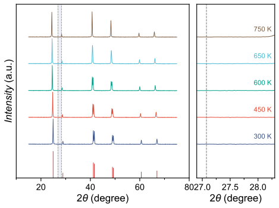
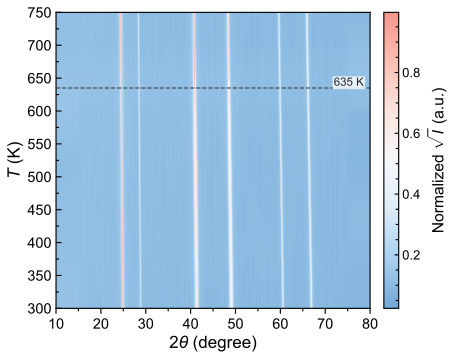
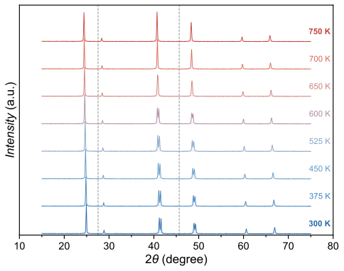
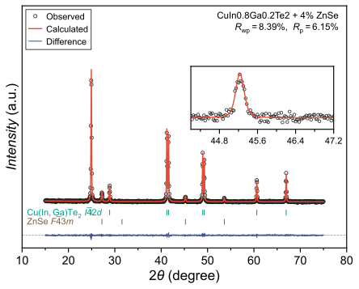
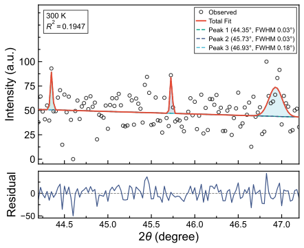
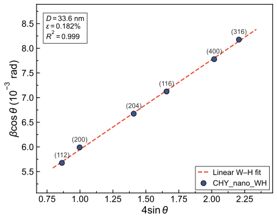

# Case 05: 多模态结构表征：原位变温 XRD 相变热图、Rietveld 精修与微观应变解析
> **6-Mode XRD Structural Characterization: Peak-Shift Zoom, In-Situ VT Maps, Rietveld & Williamson–Hall**

- **Category**: `Crystal Structure & Phase Evolution`
- **Skills Used**: `te-xrd`
- **Material System**: Chalcopyrite CuIn1-xGaxTe2 – ZnSe (300–750 K)
- **Benchmark / Reference**: TEDEX `plot-xrd` & `xrd-lattice` structural workflow suite

## 1. User Prompt (自然语言任务指令)

> 对 CuInGaTe2–ZnSe 样品系列完成一套完整的文章级结构表征作图：(1) 选定代表性谱线绘制全谱+主峰固溶峰移局部放大双栏图；(2) 300–750 K 原位变温 XRD 二维相变强度热图（标出 T_c=635 K 相变线）与热色阶瀑布图；(3) 双相 Rietveld 精修残差图；(4) 四方双峰伪 Voigt 分峰拟合；(5) Williamson–Hall 晶粒尺寸与微应变线性回归。

## 2. Agent Execution Highlights (Agent 核心推理与防呆亮点)

- 单条 `plot-xrd` 命令通过 `--zoom`、`--vt-map`、`--vt-stack`、`--rietveld`、`--peak-fit`、`--wh` 六种布局覆盖从常规物相核对到相变动力学与微结构量化的全链路。
- 支持 `--pick 13568` 按文件夹顺序精准抽取谱线并保持与 `legend.txt` 一一绑定，自动叠加双物相 PDF 标准卡片衍射棒。
- 内置 `soft-br`（柔和蓝→珊瑚红）热学色阶与图内自适应图例布局，直接导出期刊可投稿的矢量 SVG 与高分 PNG。

## 3. Reproducible CLI Commands (可复现命令)

```bash
python main.py plot-xrd showcase/cases/05_xrd_structural_and_vt_suite/data/vt_xrd_cigt --pick 13568 --zoom 26.9 28.3 --pdf-card showcase/cases/05_xrd_structural_and_vt_suite/data/CuInGaTe2_card.csv --legend --formats svg png --no-show
python main.py plot-xrd showcase/cases/05_xrd_structural_and_vt_suite/data/vt_xrd_cigt --vt-map --transition-temp 635 --formats svg png --no-show
python main.py plot-xrd showcase/cases/05_xrd_structural_and_vt_suite/data/CIGT_ZnSe_rietveld.csv --rietveld --zoom 44.2 47.2 --pdf-card showcase/cases/05_xrd_structural_and_vt_suite/data/CuInGaTe2_card.csv --pdf-card showcase/cases/05_xrd_structural_and_vt_suite/data/ZnSe_card.csv --formats svg png --no-show
python main.py plot-xrd showcase/cases/05_xrd_structural_and_vt_suite/data/CIT_nano_WH.xy --wh --pdf-card showcase/cases/05_xrd_structural_and_vt_suite/data/CuInGaTe2_card.csv --instr-fwhm 0.05 --formats svg png --no-show
```

## 4. Key Quantitative Metrics (核心定量指标)

| Metric | Value |
| --- | --- |
| Supported XRD Layouts | `8 modes (stack, separate, zoom, vt-map, vt-stack, rietveld, peak-fit, WH)` |
| In-Situ VT Window | `300 – 750 K (T_c = 635 K phase transition)` |
| Profile & Lattice Outputs | `R_wp / χ², pseudo-Voigt FWHM, D (nm) & ε, (a,b,c)` |

## 5. Publication Figures (生成图表)

### 全谱堆栈 + (112) 主峰固溶位移同步放大双栏图


### 300–750 K 原位变温 XRD (2θ, T) 二维相变热力图


### 300–750 K 变温蓝—红温度梯度瀑布图（含峰位参考线）


### 双相（CuIn0.8Ga0.2Te2 + ZnSe）Rietveld 精修拟合、残差与局部放大图


### (204)/(220) 四方劈裂双峰伪 Voigt 解卷积与残差面板


### Williamson–Hall βcosθ – 4sinθ 纳米晶粒尺寸与晶格微应变回归

