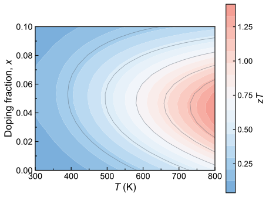
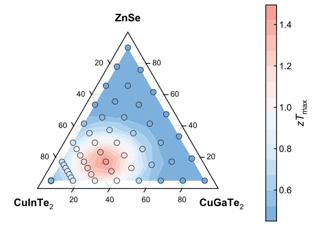
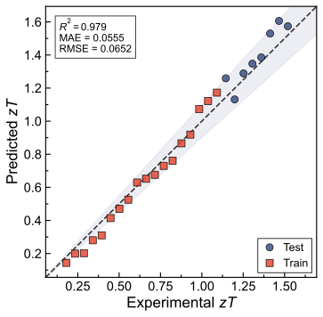
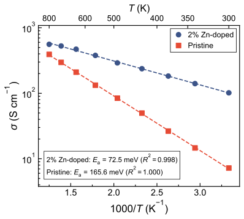
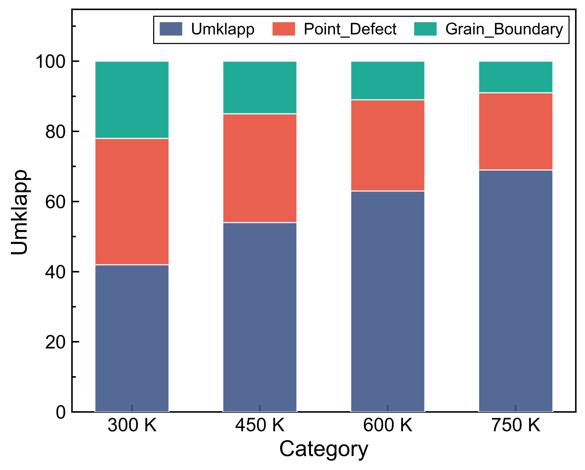
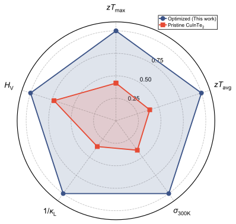

# Case 06: sciplot 通用科研图表引擎：20+ 种多维相图、统计与机器学习诊断图库
> **Unified Scientific Chart Engine (`sciplot`): 2D Phase Maps, Ternary, ML Parity, Arrhenius & Multi-Metric Plots**

- **Category**: `Scientific Data Visualization`
- **Skills Used**: `te-plotting`
- **Material System**: Cross-system thermoelectric screening, ML & device characterization
- **Benchmark / Reference**: TEDEX `sciplot` CLI & JSON Recipe Gallery

## 1. User Prompt (自然语言任务指令)

> 展示 sciplot 模块无需手写 matplotlib 脚本即可一键生成的出版级科研图表：包括热导构成堆积柱状图、100% 散射占比柱状图、zT 阶梯优化瀑布图、(T, x) 二维等高线相图、三元成分热电优值相图、机器学习预测 Parity 对角误差带图、电导率 Arrhenius 活化能自动拟合图，以及多指标归一化雷达图。

## 2. Agent Execution Highlights (Agent 核心推理与防呆亮点)

- 统一字号、线宽、内向刻度（inward ticks）与 `npg` / `soft-br` 学术配色，彻底告别 AI 临时手写脚本导致的字号不一与图例遮挡曲线问题。
- 内置 `legend_layout` 图内自适应引擎：自动搜索最低碰撞方位、调整列数与字号，并在必要时温和扩展坐标轴留白（如百分比堆积图自动锁定刻度上限在 100%）。
- 同时支持命令行直出（`te sciplot --figure contour ...`）与可版本化复用的 JSON Recipe，支持误差带、参考线、局部放大插图（Inset）等通用叠加层。

## 3. Reproducible CLI Commands (可复现命令)

```bash
python main.py sciplot showcase/cases/06_sciplot_20kind_scientific_gallery/data/contour_zt.csv --figure contour_phase_map --formats svg png --no-show
python main.py sciplot showcase/cases/06_sciplot_20kind_scientific_gallery/data/ternary_cigt.csv --figure ternary_composition --alabel CuInTe$_2$ --blabel CuGaTe$_2$ --clabel ZnSe --formats svg png --no-show
python main.py sciplot showcase/cases/06_sciplot_20kind_scientific_gallery/data/parity_zt.csv --figure parity_pred_vs_exp --formats svg png --no-show
python main.py sciplot showcase/cases/06_sciplot_20kind_scientific_gallery/data/arrhenius_sigma.csv --figure arrhenius_conductivity --formats svg png --no-show
```

## 4. Key Quantitative Metrics (核心定量指标)

| Metric | Value |
| --- | --- |
| Built-in Figure Kinds | `20+ 1D, 2D, Ternary, Statistical & Diagnostic Charts` |
| Legend Layout | `100% Inside-Axes Collision-Free Auto Placement` |
| Export Formats | `Vector SVG / PDF + High-DPI PNG + Normalized CSV` |

## 5. Publication Figures (生成图表)

### (T, x) 二维热电优值 zT 等高线相图（soft-br 配色）


### CuInTe2–CuGaTe2–ZnSe 三元固溶成分 zT 相图


### 机器学习 zT 预测 vs 实验 Parity 诊断图（自动标注 R², MAE, RMSE 与 ±10% 误差带）


### ln σ – 1000/T 双横轴 Arrhenius 拟合与热激发活化能 E_a 自动提取


### 100% 声子散射权重堆积柱状图（图内顶部留白图例，Y 轴刻度严格封顶 100%）


### 多维热电与力学综合指标雷达对比图

