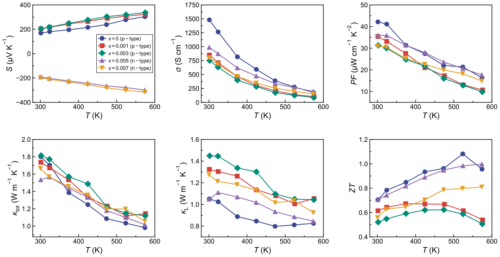
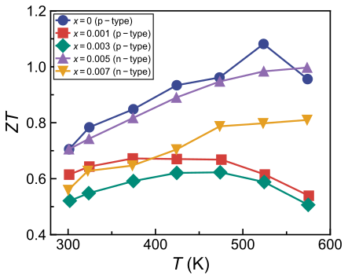
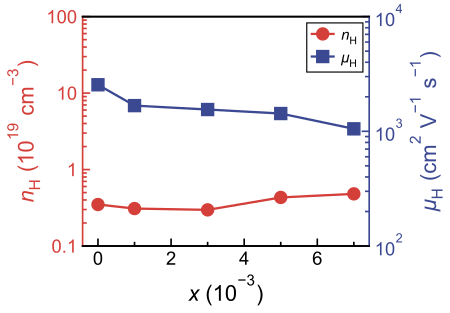
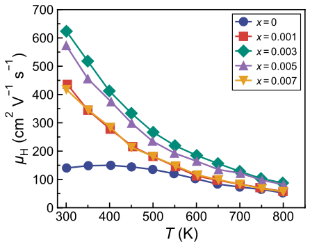
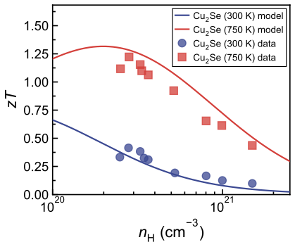
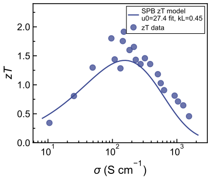

# Case 07: 经典热电材料变温输运、霍尔表征与单抛物带（SPB）全流程解析
> **Classical Bulk Thermoelectric Transport, Hall Characterization & SPB Band Modeling**

- **Category**: `Classical TE Transport & SPB`
- **Skills Used**: `te-plotting`, `te-physics-models`
- **Material System**: p→n Chalcogenide Doping Series (300–575 K), $\mathrm{Cu_2Se}$ (300 / 750 K) & $\mathrm{Cu_2(S,Se,Te)}$ (900 K)
- **Benchmark / Reference**: TEDEX Classical Transport, Hall & SPB Benchmark Suite

## 1. User Prompt (自然语言任务指令)

> 基于实验测试数据集完成一套标准热电材料论文级基础表征与能带分析图谱：绘制 p→n 型转变掺杂系列的 2×3 六联图变温热电输运总览（$S, \sigma, PF, \kappa_{\mathrm{tot}}, \kappa_{\mathrm{L}}, zT$）及单幅 $zT(T)$ 演化大图；结合室温成分双纵轴霍尔图（$n_{\mathrm{H}}, \mu_{\mathrm{H}}$）与 300–800 K 变温迁移率 $\mu_{\mathrm{H}}(T)$ 分析散射机制；并对 $\mathrm{Cu_2Se}$（300 / 750 K 霍尔轴）与 $\mathrm{Cu_2(S,Se,Te)}$（900 K 免霍尔电导率轴）执行单抛物带（SPB）优值预测拟合。

## 2. Agent Execution Highlights (Agent 核心推理与防呆亮点)

- 直接调用 `plot-te --plot-mode combined` 与 `--zt --legend` 自动识别目录中的 `legend.txt` 样品标签，生成标准 2×3 六联图与单属性大图，共享图例自动置于首面板图内空白处并智能抬升纵轴上限以避免遮挡数据点。
- 通过 `sciplot` 双纵轴（`dual_line`）与多源分组配置，统一展示室温载流子浓度/迁移率随掺杂量的演化以及 300–800 K 声学声子散射主导的迁移率衰减规律。
- 同时覆盖**有霍尔数据**（`spb performance`：$\mathrm{Cu_2Se}$ 300 K / 750 K 跨温区 $zT(n_{\mathrm{H}})$ 曲线簇）与**高温无霍尔数据**（`spb conductivity`：900 K 下直接以电导率 $\sigma$ 为横轴反推加权本征迁移率 $\mu_0 = 27.4\ \mathrm{cm^2\ V^{-1}\ s^{-1}}$ 并预测最佳电导窗口）两大经典 SPB 建模范式。

## 3. Reproducible CLI Commands (可复现命令)

```bash
python main.py plot-te showcase/cases/07_classical_te_transport_and_spb_suite/data/te_series --plot-mode combined --formats svg png --no-show
python main.py plot-te showcase/cases/07_classical_te_transport_and_spb_suite/data/te_series --zt --legend --formats svg png --no-show
python main.py sciplot --recipe showcase/cases/07_classical_te_transport_and_spb_suite/recipes/hall_composition_dual.json --no-show
python main.py sciplot --recipe showcase/cases/07_classical_te_transport_and_spb_suite/recipes/vt_hall_mobility.json --no-show
python main.py spb performance showcase/cases/07_classical_te_transport_and_spb_suite/data/cu2se_spb_series.csv --params showcase/cases/07_classical_te_transport_and_spb_suite/data/cu2se_spb_params.csv --xlim 1e20 2.5e21 --legend inside --formats svg png --no-show
python main.py spb conductivity showcase/cases/07_classical_te_transport_and_spb_suite/data/cu2ssete_900K.csv --temperature 900 --kL 0.45 --legend inside --formats svg png --no-show
```

## 4. Key Quantitative Metrics (核心定量指标)

| Metric | Value |
| --- | --- |
| Conduction Transition ($x = 0 \to 0.007$) | `p-type (+337 µV K⁻¹) → n-type (-315 µV K⁻¹), Peak zT = 1.08 / 1.00` |
| RT Hall Mobility $\mu_{\mathrm{H}}$ ($x = 0 \to 0.007$) | `140 → 623 → 418 cm² V⁻¹ s⁻¹ (n_H = 1.64–6.04 × 10¹⁹ cm⁻³)` |
| $\mathrm{Cu_2Se}$ SPB Parameters (300 / 750 K) | `m* = 2.3 / 3.2 m_e, μ_0 = 35 / 6 cm² V⁻¹ s⁻¹, Peak zT = 1.22` |
| 900 K Hall-Free $\sigma$-SPB ($\mathrm{Cu_2(S,Se,Te)}$) | `Weighted μ_0 = 27.4 cm² V⁻¹ s⁻¹ (κ_L = 0.45 W m⁻¹ K⁻¹)` |

## 5. Publication Figures (生成图表)

### 2×3 六联图变温热电输运总览（$S, \sigma, PF, \kappa_{\mathrm{tot}}, \kappa_{\mathrm{L}}, ZT$，p→n 导电类型转变）


### 单幅变温热电优值 $ZT(T)$ 掺杂演化对比图（图内自适应图例）


### 室温成分依赖霍尔载流子浓度 $n_{\mathrm{H}}$ 与迁移率 $\mu_{\mathrm{H}}$ 双纵轴图


### 300–800 K 变温霍尔迁移率 $\mu_{\mathrm{H}}(T)$ 声学声子散射衰减曲线簇


### $\mathrm{Cu_2Se}$ 300 K / 750 K 多温区单抛物带（SPB）优值 $zT(n_{\mathrm{H}})$ 预测与实验对比


### 900 K 免霍尔电导率轴 SPB 建模：$\mathrm{Cu_2(S,Se,Te)}$ 优值 $zT(\sigma)$ 拟合

