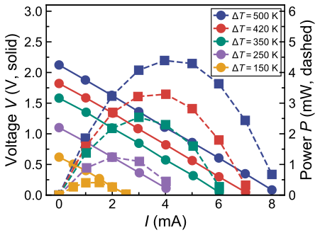
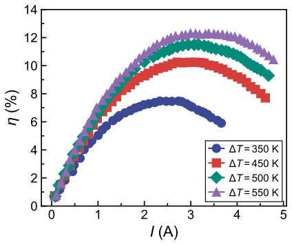
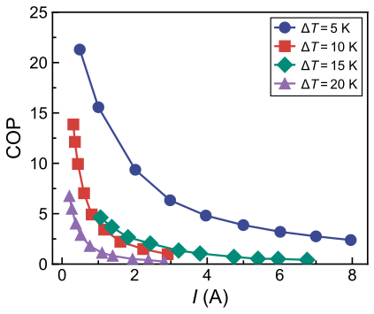
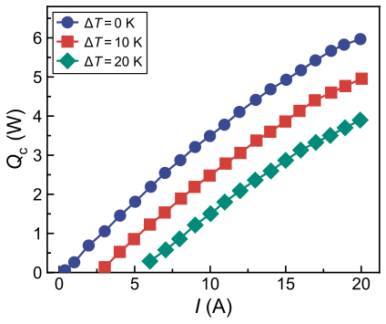

# Case 08: 热电器件服役表征：发电器件（TEG）输出功率/效率与帕尔贴制冷（TEC）性能图谱
> **Thermoelectric Module Characterization: TEG Power Generation, Conversion Efficiency & Peltier Cooling**

- **Category**: `TE Device & Module Engineering`
- **Skills Used**: `te-plotting`
- **Material System**: Multi-$\Delta T$ Thermoelectric Generator (TEG) & Peltier Cooling (TEC) Modules
- **Benchmark / Reference**: TEDEX Device Characterization Recipe Suite (`configs/plot_recipes/device/`)

## 1. User Prompt (自然语言任务指令)

> 整理并绘制热电器件级服役测试数据：包括温差发电器件（TEG）在 $\Delta T = 150\text{–}500\ \mathrm{K}$ 下的输出电压 $V(I)$ 与输出功率 $P(I)$ 双纵轴特性曲线簇、$\Delta T = 350\text{–}550\ \mathrm{K}$ 下的电流依赖转换效率 $\eta(I)$ 曲线，以及帕尔贴制冷模组（TEC）在多温差工况下的制冷系数 $\mathrm{COP}(I)$ 与制冷量 $Q_{\mathrm{c}}(I)$ 曲线，要求全部采用图内无碰撞图例与统一期刊字号配色。

## 2. Agent Execution Highlights (Agent 核心推理与防呆亮点)

- 通过 `sciplot` 的 `dual_line` 配方将开路电压线性衰减支路（实线圆点 $V$–$I$）与抛物线型输出功率支路（虚线方点 $P$–$I$）按相同温差色系配对绑定，并在图内空白角自动排布 $\Delta T = 500 \to 150\ \mathrm{K}$ 物理梯度图例。
- 通过显式 `group_order` 保证温差序列（如 $\Delta T = 5, 10, 15, 20\ \mathrm{K}$）严格按物理单调顺序排列，彻底避免按字符串字典序把 `5 K` 排在 `20 K` 之后的常见绘图瑕疵。
- 一套声明式 JSON Recipe 同时覆盖温差发电（TEG：$V, P, \eta$）与固态制冷（TEC：$\mathrm{COP}, Q_{\mathrm{c}}$）两大器件测试场景，零手写脚本即可复现矢量 `.svg` 与高清 `.png`。

## 3. Reproducible CLI Commands (可复现命令)

```bash
python main.py sciplot --recipe showcase/cases/08_te_device_power_and_peltier_cooling/recipes/teg_iv_power_dual.json --no-show
python main.py sciplot --recipe showcase/cases/08_te_device_power_and_peltier_cooling/recipes/teg_conversion_efficiency.json --no-show
python main.py sciplot --recipe showcase/cases/08_te_device_power_and_peltier_cooling/recipes/tec_peltier_cop.json --no-show
python main.py sciplot --recipe showcase/cases/08_te_device_power_and_peltier_cooling/recipes/tec_cooling_capacity_qc.json --no-show
```

## 4. Key Quantitative Metrics (核心定量指标)

| Metric | Value |
| --- | --- |
| TEG Open-Circuit Voltage & Peak Power ($\Delta T = 500\ \mathrm{K}$) | `V_oc = 2.12 V, P_max = 4.40 mW (at I ≈ 4.0 mA)` |
| Peak TEG Conversion Efficiency ($\Delta T = 550\ \mathrm{K}$) | `η_max = 12.3% (at I ≈ 3.1 A)` |
| Peak Peltier Cooling COP ($\Delta T = 5\ \mathrm{K}$) | `COP_max = 21.3 (at low operating current)` |
| Maximum Cooling Capacity $Q_{\mathrm{c}}$ ($\Delta T = 0\ \mathrm{K}$) | `Q_c,max = 5.97 W (at I = 19.9 A)` |

## 5. Publication Figures (生成图表)

### 多温差 TEG 发电模组输出电压 $V(I)$（实线）与输出功率 $P(I)$（虚线）双纵轴特性曲线簇


### TEG 发电模组电流依赖热电转换效率 $\eta(I)$ 曲线簇（峰值 $\eta_{\max} = 12.3\%$）


### TEC 帕尔贴制冷模组多温差制冷系数 $\mathrm{COP}(I)$ 特性曲线簇


### TEC 帕尔贴制冷模组电流依赖制冷功率 $Q_{\mathrm{c}}(I)$ 曲线簇

